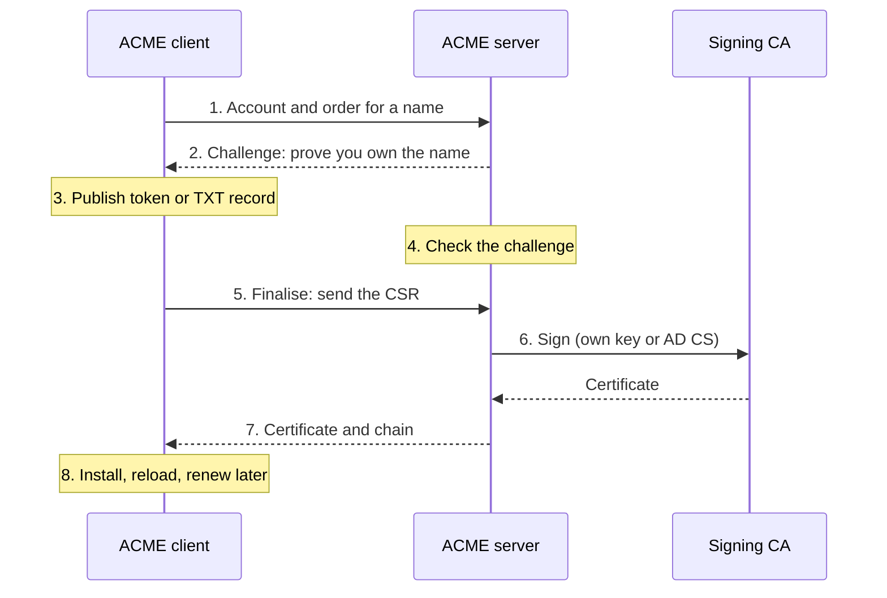
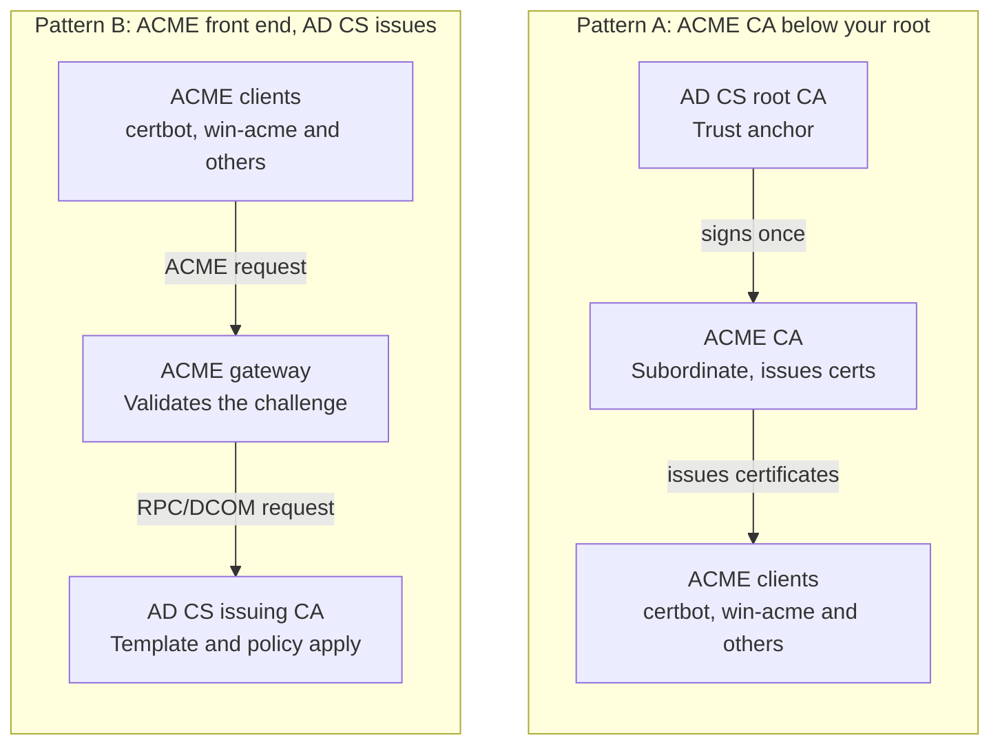
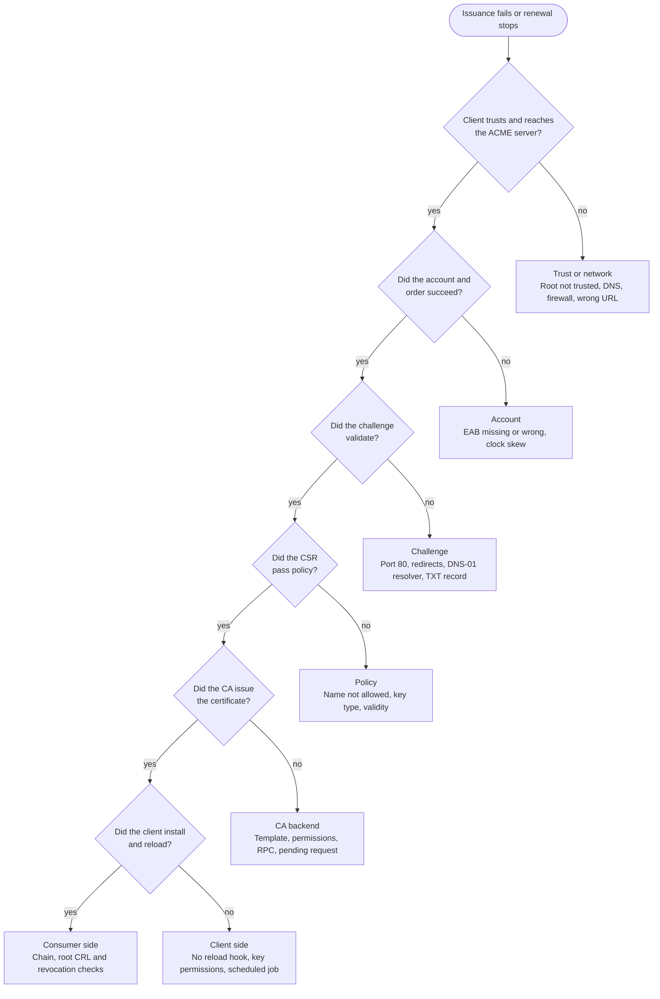

# ACME Integration with AD CS

Earlier introduced ACME as the standard way to automate certificates. This module is about the practical question that follows: AD CS does not speak ACME, so how do you give ACME clients certificates from your Microsoft PKI? It explains the integration patterns, how each one works, how to build and secure it, and how to troubleshoot it when renewals stop working.

## Contents

1. [ACME in two minutes (a quick refresher)](#1-acme-in-two-minutes)
2. [The problem, and the three integration patterns](#2-the-problem-and-the-three-patterns)
3. [Pattern A: an ACME CA that is a subordinate of your AD CS root](#3-pattern-a-an-acme-ca-below-your-ad-cs-root)
4. [Pattern B: an ACME front end that requests certificates from AD CS](#4-pattern-b-an-acme-front-end-with-ad-cs-as-the-issuer)
5. [Pattern C: script-based bridges](#5-pattern-c-script-based-bridges)
6. [Choosing a pattern](#6-choosing-a-pattern)
7. [Implementation guide](#7-implementation-guide)
8. [Client onboarding](#8-client-onboarding)
9. [Security and governance](#9-security-and-governance)
10. [Operations and monitoring](#10-operations-and-monitoring)
11. [Issues and troubleshooting](#11-issues-and-troubleshooting)
12. [Module review, document-your-build checklist and interview questions](#12-module-review)

---

## 1. ACME in Two Minutes

ACME (RFC 8555) lets a client get and renew certificates with no human involved. The idea is simple: the client proves it controls a name, then sends a CSR, and the server issues the certificate.

| Step | What happens |
|---|---|
| 1. Account | The client registers an account key with the ACME server (sometimes with an External Account Binding key from the administrator) |
| 2. Order | The client asks for a certificate for one or more names |
| 3. Challenge | The server asks the client to prove control of each name |
| 4. Finalise | The client sends a CSR |
| 5. Issue | The server returns the certificate chain |
| 6. Renew | A scheduled job repeats the process before expiry |

The three challenge types are **HTTP-01** (a file on port 80), **DNS-01** (a TXT record, needed for wildcards) and **TLS-ALPN-01** (a special handshake on port 443). Everything in this module is about **where the ACME server sits** and **who actually signs the certificate**.

### ACME in one picture: prove the name, send a CSR, get the certificate



*ACME flow: 8 steps, 3 parties.*

The signing CA in step 6 is the one thing that changes between the integration patterns: it is either the ACME server's own subordinate CA (Pattern A) or your AD CS issuing CA (Pattern B).

---

## 2. The Problem and the Three Patterns

### Why AD CS needs help

AD CS issues certificates through autoenrollment, CEP/CES, NDES/SCEP and RPC/DCOM requests. It has no ACME endpoint. But most non-Windows systems (Linux servers, containers, Kubernetes, load balancers, reverse proxies, many appliances) already have an ACME client built in or easy to add. If you want these systems to use your internal PKI without writing custom enrollment code, you need something that speaks ACME on the front and connects to your PKI on the back.

### The three patterns

| Pattern | Idea | Who signs the certificate | AD CS role |
|---|---|---|---|
| **A. ACME CA below your AD CS root** | Run an ACME-capable CA (for example step-ca) as a subordinate CA signed by your AD CS root | The ACME CA | Trust anchor only. It signs the ACME CA's certificate once |
| **B. ACME front end with AD CS as the issuer** | An ACME server or gateway validates the client, then submits the CSR to AD CS | The AD CS issuing CA | Real issuing CA, with templates and policy |
| **C. Script-based bridge** | Your own scripts call `certreq` or PowerShell and mimic the flow | The AD CS issuing CA | Real issuing CA, but without the ACME protocol |

### Two ways to connect ACME to AD CS



*ACME integration patterns: A and B side by side.*

The diagrams in this module are deliberately simple. Pattern A moves the issuing job to a new CA that your root trusts. Pattern B keeps AD CS as the issuer and puts a translator in front of it.

---

## 3. Pattern A: An ACME CA Below Your AD CS Root

### How it works

You deploy a separate CA product that supports ACME and make it a **subordinate (issuing) CA of your existing root**. Because the clients already trust your root, they automatically trust certificates from the ACME CA. The ACME CA then issues certificates itself, validating challenges and signing with its own key. AD CS is involved only once, when the root signs the ACME CA's certificate.

A popular open source choice is **step-ca (Smallstep)**. Many guides describe running step-ca as a sub CA of a Windows root so that Active Directory clients accept its certificates, and then enabling its ACME provisioner for Windows and Linux services.

The chain is: `Your Root CA (AD CS)` signs `ACME Issuing CA (step-ca)`, which signs the `server certificate` that the ACME client receives.

### Strengths and limits

| Strengths | Limits |
|---|---|
| Simple ACME story, because the ACME CA is built for it | The issuing keys and policy live outside AD CS. You now run two PKIs under one root |
| No RPC/DCOM connection to AD CS, so it works well across networks and for containers | AD CS templates, permissions and auditing do not apply to these certificates |
| Short-lived certificates are easy | You must provide revocation (CRL or OCSP) from the ACME CA, or rely on short lifetimes |
| Clients that already trust your root need no change | The ACME CA key must be protected as carefully as any issuing CA key |

### Design points specific to Pattern A

- **Path length.** If your root is built with a path length of 1 (Module 03), the root can only sign CAs directly below it. That is fine here. The ACME CA must be signed by the root, as a sibling of your normal issuing CA, and not by the issuing CA (whose path length is normally 0).
- **Constrain the CA.** Ask for name constraints in the ACME CA certificate (for example only your internal DNS domains) and a path length of 0, so a compromise of that CA cannot be used to issue certificates for names outside your control.
- **EKU limits.** Restrict the ACME CA to ServerAuthentication (and Client Authentication if you need it).
- **Revocation and AIA.** The ACME CA certificate carries the root's CDP and AIA. The certificates it issues need their own reachable HTTP CDP and AIA (or OCSP), set in the ACME CA's configuration. Check what your ACME CA supports, because many rely on short lifetimes and passive revocation.
- **Key protection.** Prefer an HSM or a strongly protected key store for the ACME CA's signing key.

---

## 4. Pattern B: An ACME Front End with AD CS as the Issuer

### How it works

An ACME server (or gateway) receives the ACME requests, completes the challenge validation itself, and then sends the CSR to your AD CS issuing CA using the normal Microsoft request interface (MS-WCCE over RPC/DCOM, or web enrollment). AD CS applies a template and issues the certificate, and the ACME server hands it back to the client. Several certificate management products offer this, including Keyfactor, Venafi (CyberArk), Infisical and others. Some describe AD CS as an external CA that they connect to through a gateway.

The chain is: `Your Root CA` signs `Your Issuing CA (AD CS)`, which signs the `server certificate`. The certificates look exactly like any other AD CS certificate, so existing trust, CDP and AIA, OCSP and monitoring all continue to work.

### Strengths and limits

| Strengths | Limits |
|---|---|
| AD CS stays the single issuer, so templates, permissions, auditing, CRLs and OCSP all apply | Needs a product or gateway, which may be commercial |
| One PKI to run and to audit | The ACME server needs network access to the CA (RPC/DCOM) and a service account |
| Easy to meet compliance requirements | The service account is powerful, so it must be tightly scoped |
| Revocation uses the AD CS CRL and OCSP you already have | AD CS must scale to the shorter lifetimes and higher volumes ACME brings |

### How the AD CS side is set up

- A dedicated template for ACME-issued certificates, for example `Contoso-ACMEWebServer`. It normally uses **Supply in the request** for the subject and SAN, because the names come from the ACME order.
- **Enroll** permission only for the gateway's service account (or its computer account), never for broad groups.
- A short validity (for example 30 to 90 days) and a renewal period that matches how often the ACME clients renew.
- ServerAuthentication as the only EKU (add Client Authentication only if needed).
- RSA 2048 or higher (or ECC if all your consumers support it), SHA-256 or better, and no private key export (the key is created by the client, not the CA).
- The ACME server enforces which names a client may request, because AD CS will trust whatever the CSR contains when Supply in the request is used (see [Security](#9-security-and-governance)).

### Validation: who checks what

In Pattern B, the ACME server performs the challenge (HTTP-01 or DNS-01) and only then asks AD CS to issue. AD CS itself never sees the challenge. Some products allow skipping domain validation for internal names, which is convenient but means every client that can reach the ACME server can obtain a certificate for any allowed name. Use it only for trusted internal domains, with EAB and name allow-lists.

---

## 5. Pattern C: Script-Based Bridges

Some teams build a quick bridge with PowerShell or shell scripts that call `certreq`, or use the web enrollment pages, from a scheduled job. This can solve a one-off need, but it is **not ACME**: there is no standard account, challenge or renewal logic, and every consumer needs custom code. It is also hard to secure and audit. Treat it as a temporary stop and move to Pattern A or B when you can.

---

## 6. Choosing a Pattern

| Question | Points to A | Points to B |
|---|---|---|
| Do you need AD CS templates, audit and policy on every certificate? | No | Yes |
| Do you need one issuing CA for compliance? | No | Yes |
| Are the consumers containers or workloads that cannot reach AD CS over RPC? | Yes | Not directly (the gateway can reach AD CS instead) |
| Do you want short-lived certificates at high volume with the least load on AD CS? | Yes | Possibly with design care |
| Do you want a free, open source solution? | Yes (for example step-ca) | Usually commercial |
| Is operating two PKIs acceptable? | Yes | No |

A common outcome is a **hybrid**: Pattern A for developer and container workloads, and Pattern B (or normal AD CS enrollment) for regulated systems.

---

## 7. Implementation Guide

### 7.1 Common prerequisites

- A working two-tier AD CS PKI with reachable HTTP CDP and AIA (Modules 02 and 03).
- DNS names for the ACME server (for example `acme.contoso.com`) and a TLS certificate for it, trusted by the clients.
- Time synchronisation on every machine involved.
- A decision on which names may be requested, which challenge types are allowed, and maximum validity.
- Distribution of the root (and issuing CA) certificate to the clients, through Group Policy, Intune or your configuration management.

### 7.2 Pattern A step by step (step-ca as an example)

1. Install step-ca on a hardened server (Linux is typical, with a hardened service account) with an internal DNS name.
2. Create the intermediate CA key and CSR on the step-ca server, rather than creating a self-signed root. Set the subject (for example `Contoso ACME CA 01`).
3. Get the CSR signed by your AD CS root. Use the normal subordinate CA process: submit the request with `certreq -submit`, issue it in the CA console (a standalone root holds it as pending), and retrieve the certificate. Make sure the template or request gives a path length of 0, a CA key usage, and, ideally, name constraints.
4. Install the signed certificate and chain in step-ca's configuration, so the chain is root, then ACME CA.
5. Add the ACME provisioner: `step ca provisioner add acme --type ACME`. Step-ca has options for the maximum and default certificate duration on the provisioner, so set a short default (for example about a month) and a maximum that matches your policy. Restart step-ca afterwards.
6. Find the ACME directory URL. It takes this form: `https://<yourserver>/acme/<provisioner-name>/directory`. For a provisioner named `acme` it is `https://acme.contoso.com/acme/acme/directory`.
7. Test the directory from a client: `curl --cacert root.crt https://acme.contoso.com/acme/acme/directory`. You should get a JSON document.
8. Plan revocation. Decide whether the ACME CA publishes a CRL or OCSP, and put reachable HTTP locations into the issued certificates, or rely on short lifetimes and document that decision.
9. Publish the ACME CA certificate to your AIA location and keep it in your CA inventory.

### 7.3 Pattern B step by step (generic)

1. Choose and install the ACME server or gateway (a commercial platform, or a product with an AD CS connector). Place it on the internal network with HTTPS and a trusted certificate.
2. Create the service account the gateway will use, and give it **Request Certificates** on the issuing CA and **Read** and **Enroll** on only the ACME template.
3. Create and publish the ACME template as described in [Section 4](#4-pattern-b-an-acme-front-end-with-ad-cs-as-the-issuer).
4. Open the network path from the gateway to the CA: TCP 135 and the CA's RPC port range (or HTTPS to web enrollment, depending on the product).
5. Add AD CS as an issuer in the product, with the CA name (in the form `server\CAName`) and the template name.
6. Define the ACME endpoint: the directory URL, allowed domains, allowed challenge types, whether EAB is required, and the maximum validity.
7. Test with one client, then check the CA's Issued Certificates list: the certificate should show your template and the gateway account as the requester.
8. Publish the directory URL and documentation to your teams.

### 7.4 What to test before announcing it

- A certificate request for an allowed name works, and one for a blocked name fails.
- HTTP-01 and DNS-01 each work from a realistic client network.
- A forced renewal works (for example `certbot renew --force-renewal`).
- The issued certificate validates on a client, including revocation checking (`certutil -urlfetch -verify` on Windows).
- The web server reloads and serves the new certificate after renewal.

---

## 8. Client Onboarding

### 8.1 Trust the internal CA first

The ACME client must trust your root so that it can talk to the ACME server over HTTPS. This is the most common first failure. Typical settings:

| Client | How to trust the internal root |
|---|---|
| certbot | Set `REQUESTS_CA_BUNDLE` to the root certificate file when running it, and use `--server <directory URL>` |
| acme.sh | Use `--server <directory URL>` and `--ca-bundle <root.crt>` |
| Caddy | Set the `acme_ca` directory URL and `acme_ca_root` |
| win-acme (Windows) | Point its base URI settings to your ACME directory. Windows clients already trust the root if it is in the machine store through Group Policy |
| cert-manager (Kubernetes) | Create an ACME issuer with your server URL and provide the CA bundle |

Example with certbot:

```bash
certbot certonly -n --standalone -d app.contoso.com --server https://acme.contoso.com/acme/acme/directory
```

### 8.2 Choose the challenge type

| Challenge | Use when | Requirement |
|---|---|---|
| HTTP-01 | The client is reachable from the ACME server on port 80 | Inbound port 80 from the ACME server, no redirect to HTTPS at the challenge path, DNS name resolves to the client |
| DNS-01 | Wildcards, or clients that cannot be reached | A way to create TXT records (for example PowerShell against Windows DNS, or a DNS API). The ACME server must be able to see the new TXT record, so it should query the same DNS server (step-ca has a resolver option for this) |
| TLS-ALPN-01 | Only port 443 is open | The client or proxy supports it |

For Windows DNS, there are community hooks (for example a certbot hook that runs PowerShell over SSH against the DNS server) that create and remove the TXT record. Give the account that updates DNS only the permission it needs on the `_acme-challenge` records.

### 8.3 Schedule renewals and reload the service

ACME clients renew from a scheduled job. certbot uses a timer or cron entry, and win-acme uses a scheduled task. A common pattern is to run the check once or twice a day and renew when about two-thirds of the lifetime has passed.

- Use a **deploy hook** to reload the web server or application after a successful renewal. A renewed certificate that is not loaded is the same as an expired one.
- On Windows, make sure the scheduled task account can write the certificate store and that the application account can read the private key.

### 8.4 Linux, Windows and containers

- **Linux web servers:** certbot with the nginx or apache plugin, or standalone mode with a hook.
- **IIS:** win-acme can create the certificate, import it and update the site binding.
- **Kubernetes:** cert-manager with an ACME issuer pointing to the internal directory URL.
- **Appliances and load balancers:** use the built-in ACME or Let's Encrypt setting and replace the directory URL with the internal one, where the product allows it.

---

## 9. Security and Governance

Automation makes it easy to get certificates, which is the goal, and also easy to get them wrongly. The ACME server becomes a gatekeeper and needs the same care as a CA.

| Risk | What to do |
|---|---|
| Anyone can request any name | Define an allow-list of domains, and require External Account Binding (EAB) so only registered clients can create accounts |
| Skipping validation on internal names | Only do this for trusted internal domains. Otherwise keep HTTP-01 or DNS-01 validation on |
| Stolen ACME account key | Treat account keys as secrets. Limit what each account may request. Rotate on compromise |
| Over-privileged gateway service account (Pattern B) | Enroll rights on one template only, no admin rights, strong password management, monitoring of its use. Remember Supply in the request means the gateway must enforce name rules |
| ACME CA key theft (Pattern A) | HSM or hardened key store, name constraints, path length 0, restricted network access |
| DNS credentials for DNS-01 | Use a dedicated low-privilege account limited to the challenge records, and keep the credential out of the repository and the logs |
| Wildcards | Limit them. A wildcard certificate has a large blast radius |
| Long validity | Use short lifetimes. They reduce the need for revocation and limit damage |
| Weak keys and algorithms | Enforce RSA 2048 or higher or ECC, and SHA-256 or better, at the ACME server and the template |
| No audit trail | Log every ACME order, the account, the requested names and the result, and send logs to your SIEM |

Also apply the lessons from Module 04: a template that allows Supply in the request with an authentication EKU is dangerous if it is open to many requesters. For ACME, keep the EKU to ServerAuthentication and the permissions to the gateway only.

---

## 10. Operations and Monitoring

### What to monitor

| Signal | Why |
|---|---|
| Renewal success and failure per client and per name | The main health measure of the whole system |
| Certificate expiry from the consumer's point of view | Catches silent renewal failures and certificates that were issued but not loaded |
| ACME server availability and latency | If it is down, renewals pile up |
| Order and challenge failure counts | Spikes show misconfiguration or abuse |
| AD CS events 4886 to 4889 (Pattern B) | Shows requests, issued certificates, denials, template and requester (Module 05) |
| CRL and OCSP health | Revocation must keep working for the issuing CA used |
| Root and intermediate expiry | The ACME CA certificate (Pattern A) and the issuing CA certificate must be renewed on time |
| Disk and database size | Many short-lived certificates grow the CA database (Module 06) |

### Good practice

- Alert when a certificate has less than one third of its life left and has not renewed.
- Run a synthetic renewal test regularly (for example a dry run against the real server).
- Keep runbooks for: an ACME server outage, a failed challenge, an expired ACME CA certificate, and a compromised ACME account.
- Plan capacity. At 30 to 90 day lifetimes, certificate volume multiplies compared with yearly certificates.
- Review the allow-lists, EAB accounts and templates every quarter.

---

## 11. Issues and Troubleshooting

### 11.1 A method that works

Follow the request through the same stages every time and stop at the first one that fails:

1. Can the client reach and trust the ACME server?
2. Did the account and order succeed?
3. Did the challenge validate?
4. Did the CSR pass policy?
5. Did the CA issue the certificate (and, in Pattern B, did AD CS accept the request)?
6. Did the client install it and reload the service?
7. Does the certificate validate on a consumer, including revocation?

### ACME troubleshooting: the first stage that fails is the layer to open



*ACME troubleshooting path: 6 questions, 6 outcomes.* Work down the left side. The first question that gets a "no" tells you which layer to open, and the tables below list the causes for each one.

### 11.2 Client to ACME server

| Symptom | Likely cause | What to do |
|---|---|---|
| TLS error such as `certificate verify failed` or unknown CA | The client does not trust your internal root, or the ACME server presents an incomplete chain | Give the client the root (for certbot, set `REQUESTS_CA_BUNDLE`; for acme.sh use `--ca-bundle`; for Caddy use `acme_ca_root`) and check the server's TLS chain |
| Cannot connect or timeout | DNS, firewall, proxy or wrong port | Test with `curl` against the directory URL from the client's network |
| Directory URL returns 404 | Wrong path or provisioner name | The path includes the provisioner name, for example `/acme/acme/directory` |
| Unauthorized or account errors | EAB required but missing or wrong, or the account was deleted | Supply the EAB key ID and secret, or register a new account |
| Clock errors | Large time difference between client and server | Fix time synchronisation |

### 11.3 Challenge failures

| Symptom | Likely cause | What to do |
|---|---|---|
| HTTP-01 fails with connection refused or timeout | Port 80 is blocked between the ACME server and the client, or nothing listens on it | Open the port, or use standalone mode, or switch to DNS-01 |
| HTTP-01 fails with the wrong content or 404 | A web server redirect or a reverse proxy changes the challenge path, or the path is not served | Serve `/.well-known/acme-challenge/` directly over HTTP, with no redirect |
| HTTP-01 fails because the name points elsewhere | DNS resolves the name to another server (for example a load balancer) | Fix DNS, or use DNS-01 |
| DNS-01 fails: TXT record not found | The ACME server queries a different DNS server from the one that holds the new record (split-horizon DNS) | Make the ACME server use the same DNS server as the one updated by your hook (step-ca has a resolver setting for this) |
| DNS-01 fails: record exists but not yet visible | Replication or propagation delay | Add a wait in the hook, and lower the TTL on the challenge record |
| DNS-01 hook fails | Wrong credentials or permissions to update DNS | Test the hook by hand, and check the account's rights on the challenge records |
| Wildcard refused | Wildcards need DNS-01, or policy blocks them | Use DNS-01 or request explicit names |

### 11.4 Policy and CSR rejections

| Symptom | Likely cause | What to do |
|---|---|---|
| Name not allowed | The name is outside the allow-list or the CA's name constraints | Update the policy through change control, or request an allowed name |
| CSR rejected: key type or size | The key is too small or the algorithm is not permitted | Generate a stronger key (for example RSA 2048 or higher) |
| Validity not as expected | The client asked for more than the maximum, or the template or provisioner limits it | Check the provisioner duration settings and the template validity |
| SAN mismatch | The CSR names differ from the validated order | Make the CSR match the order exactly, including the common name rules of the server |

### 11.5 AD CS backend errors (Pattern B)

On the CA, use the **Failed Requests** node and the Security events **4886 to 4889** to see the requester, the template and the outcome for each request.

| Symptom | Likely cause | What to do |
|---|---|---|
| Issuance fails with `0x80094800` (unsupported certificate type) | The template is not published on that CA, or the name in the gateway is wrong | Publish the template on the issuing CA and check the template name used in the gateway |
| Access denied (`0x80070005`) | The gateway account lacks Enroll on the template, or Request Certificates on the CA | Check the template Security tab and the CA Security tab |
| RPC server unavailable (`0x800706BA`) | The gateway cannot reach the CA (firewall, DNS, RPC ports) | Open TCP 135 and the CA's RPC range, or fix name resolution |
| Request pending | The template or CA requires manager approval | Remove the approval requirement for this template, or approve the requests in the CA console |
| Denied by the CA | Subject or SAN does not meet the template policy | Review the template settings and the audit event 4888 for details |
| Slow issuance or timeouts under load | The CA is under heavy load from many short-lived certificates | Stagger renewals, scale the CA, and tune the database (Module 06) |

### 11.6 Chain, trust and revocation problems

| Symptom | Likely cause | What to do |
|---|---|---|
| Browser or client says the certificate is untrusted | The consumer does not trust your root, or the server is sending only the leaf certificate | Install the root on the consumer, and configure the server with the full chain (use the full chain file from the ACME client, not just the certificate file) |
| Revocation check fails (offline error) | The CDP or OCSP location in the issued certificates is not reachable, or the CRL has expired | Check the URLs in the certificate and test with `certutil -urlfetch -verify`. For Pattern A, check the ACME CA's own revocation setup. For Pattern B, check the issuing CA's CRL (Module 02) |
| Chain fails only for the ACME CA | The AIA for the ACME CA certificate is wrong or the root CRL expired | Publish the ACME CA certificate to AIA and renew the root CRL on time |
| Certificate valid, but the application still shows the old one | The service was not reloaded, or an old certificate is still bound | Run the deploy hook, restart the service, and check the binding |

### 11.7 Renewal problems

| Symptom | Likely cause | What to do |
|---|---|---|
| Works the first time, fails on renewal | A firewall rule was temporary, the web server changed, or credentials expired | Run `certbot renew --dry-run` (or the equivalent) to see the exact error |
| Scheduled job does not run | The timer or task is disabled, or the account has no rights | Check the cron entry, systemd timer or scheduled task and its logs |
| Renewed, but old certificate still served | No reload hook | Add a deploy hook that reloads the service |
| Private key permission errors on Windows | The application account cannot read the key from the machine store | Grant read access on the private key to the service account |
| Many clients fail at the same time | The ACME CA or root certificate expired, or the ACME server is down | Check expiry of the chain and server health, and renew in advance |
| Rate or load problems | Too many clients renew at once | Stagger renewal times with a random delay |

### 11.8 Useful commands

| Task | Command |
|---|---|
| Test the directory | `curl --cacert root.crt https://acme.contoso.com/acme/acme/directory` |
| Dry-run a renewal | `certbot renew --dry-run` |
| Force a renewal | `certbot renew --force-renewal` |
| Check the DNS challenge record | `nslookup -type=TXT _acme-challenge.app.contoso.com <dns-server>` |
| Inspect a certificate on Windows | `certutil -v -dump cert.cer` |
| Check chain and revocation | `certutil -urlfetch -verify cert.cer` |
| On the CA | Look at the Failed Requests node and Security events 4886 to 4889 |
| On certbot clients | Read `/var/log/letsencrypt/letsencrypt.log` |

### 11.9 Illustrative scenarios

These scenarios are built from the causes above to show how the pieces fit together. They are not reports of real incidents.

- **Scenario 1: certbot says `certificate verify failed`.** The Linux server does not trust the internal root. Setting `REQUESTS_CA_BUNDLE` to the root certificate solved it. *Lesson: trust first, then challenge.*
- **Scenario 2: DNS-01 works in testing, fails in production.** In production the ACME server used a different DNS resolver that never saw the TXT record created on the internal Windows DNS server. Pointing the ACME server's resolver at the internal DNS fixed it.
- **Scenario 3: certificates issue but browsers complain.** The web server was configured with only the leaf certificate. Switching to the full chain file fixed it, and the revocation check passed once the chain was complete.
- **Scenario 4 (Pattern B): every request is denied.** The ACME gateway's service account had no Enroll permission on the new template. Adding Read and Enroll for that account only, and publishing the template on the issuing CA, fixed it.
- **Scenario 5: renewals stop after three months.** The ACME CA certificate, or the root CRL, expired. Chain monitoring and a calendar reminder for the root CRL (Module 06) prevent a repeat.

---

## 12. Module Review

### Key points

- AD CS has no native ACME support. To serve ACME clients from a Microsoft PKI you need a front end.
- **Pattern A:** an ACME-capable CA (such as step-ca) is a subordinate CA signed by your AD CS root. It issues the certificates itself, so AD CS templates and auditing do not apply. Use path length 0, name constraints, and strong key protection.
- **Pattern B:** an ACME server or gateway validates the challenge and then requests the certificate from AD CS with a service account and a dedicated template. AD CS stays the issuer, so revocation, audit and policy remain in one place.
- **Pattern C** (scripts) is a temporary workaround and not real ACME.
- Clients must trust your root before they can talk to the ACME server. Choose the challenge type to fit the network: HTTP-01 for reachable hosts, DNS-01 for wildcards and private hosts.
- Govern it. Use domain allow-lists, EAB, short lifetimes, limited wildcards, least-privilege service accounts and DNS credentials, and full logging.
- Monitor renewals, certificate expiry, the ACME server, the chain (including the root CRL), and the CA database.
- Troubleshoot in order: trust, account, challenge, policy, issuance, installation, then validation.

### Document your own build

Use this list to record the integration you built, so you can explain it in an interview or hand it over:

| Item | Your answer |
|---|---|
| Pattern used (A, B or C) and why | |
| ACME server or product, version, and where it runs | |
| Hierarchy: who signs the ACME CA or which AD CS issuing CA is used | |
| Template name and settings (Pattern B) or CA constraints (Pattern A) | |
| Service account and its permissions (Pattern B) | |
| Challenge types allowed, and how DNS-01 is done | |
| Allowed domains and EAB policy | |
| Certificate lifetime and renewal timing | |
| Clients supported (certbot, win-acme, cert-manager, appliances) | |
| How the root is trusted (GPO, Intune, manual) | |
| Revocation approach and CDP/AIA/OCSP locations | |
| Monitoring and alerting | |
| Issues you hit and how you fixed them | |

### Common interview questions

**Does AD CS support ACME?**
Not natively. You add an ACME server in front of it, or run an ACME-capable CA below your root.

**Explain the two main integration patterns.**
In the first, an ACME CA is a subordinate of the AD CS root and issues certificates itself. In the second, an ACME server validates the client and requests the certificate from AD CS.

**What are the trade-offs between them?**
The first is simpler and lighter on AD CS but creates a second issuing PKI without AD CS templates and audit. The second keeps AD CS as the single issuer but needs a gateway, a service account and RPC/DCOM access.

**Why must the ACME CA's path length be 0?**
So it can only issue end-entity certificates, which limits the damage if it is compromised.

**Why use name constraints on the ACME CA?**
So it cannot issue certificates for names outside your internal domains, even if compromised.

**What does the ACME client need before it can talk to an internal ACME server?**
Trust for the internal root certificate.

**When would you use DNS-01 instead of HTTP-01?**
For wildcard certificates, for servers that are not reachable on port 80, or where DNS automation is easier than opening ports.

**What goes wrong with DNS-01 in split DNS?**
The ACME server may query a different DNS server from the one that holds the TXT record, so it never sees the challenge.

**How do you stop anyone from getting a certificate for any name?**
Domain allow-lists, EAB, restricted accounts, validation turned on, and a tightly scoped template and service account.

**What AD CS template settings suit ACME in Pattern B?**
A dedicated template with Supply in the request, ServerAuthentication only, short validity, no private key export, and Enroll for the gateway's account only.

**How do you handle revocation with short-lived certificates?**
Short lifetimes reduce the window, but you still publish a CDP or OCSP, and keep the ability to revoke if a key is compromised.

**A renewal worked last month and failed this month. How do you investigate?**
Run a dry run to see the exact error, check trust, the challenge path, the account, the CA backend, the chain and root CRL expiry, and the scheduled job.

**Why is a deploy hook important?**
A renewed certificate is useless until the service reloads and uses it.
