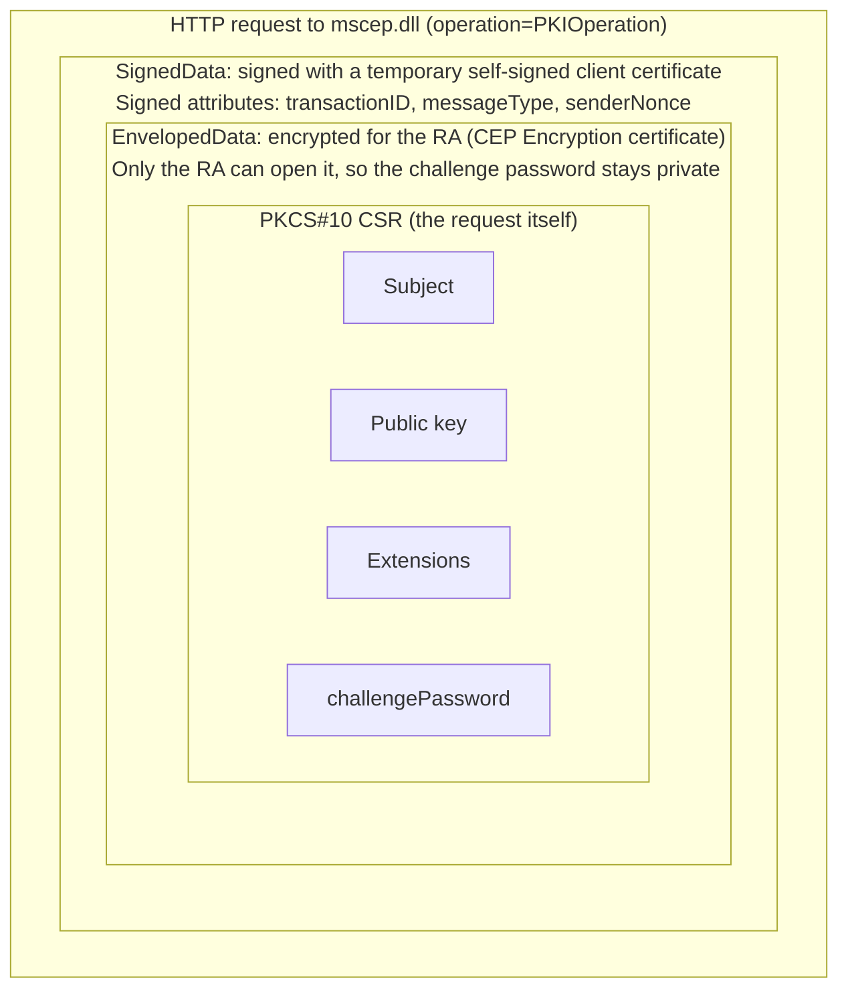
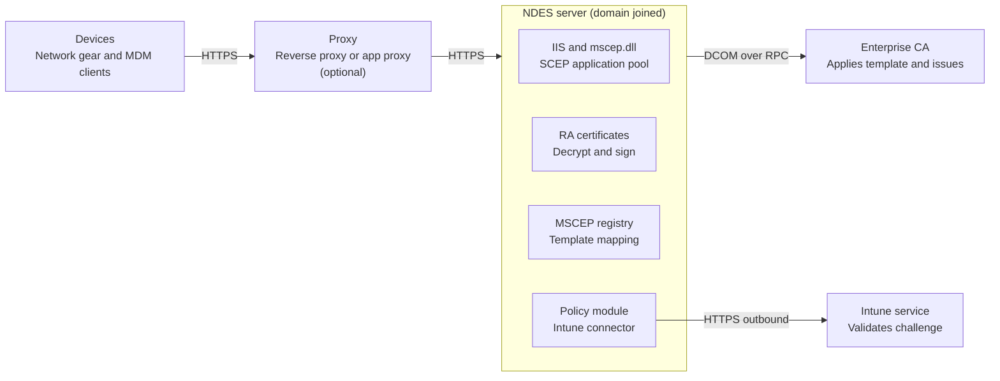
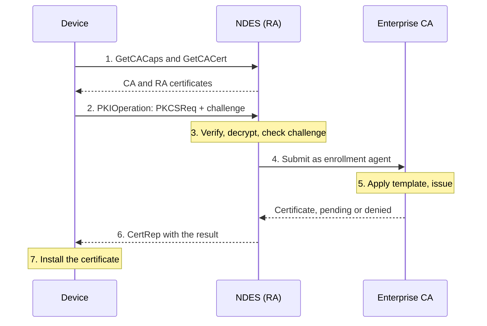
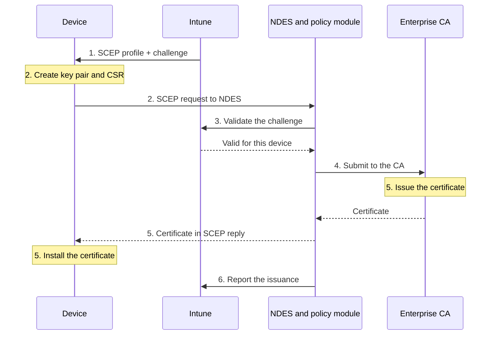
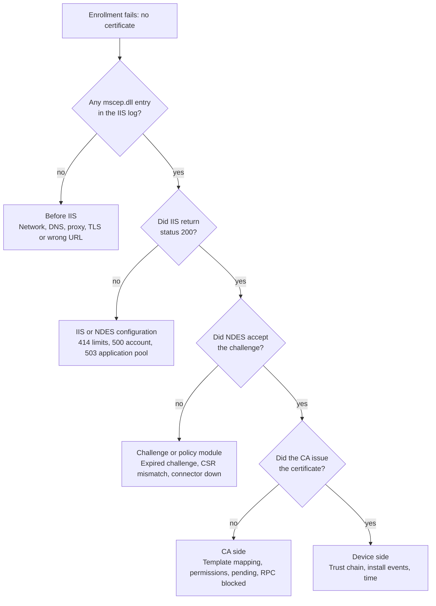

# NDES and SCEP Deep Dive

NDES and SCEP are how a Microsoft PKI hands certificates to devices that cannot use Active Directory, such as routers, firewalls, Wi-Fi controllers and mobile devices managed by Intune. They are simple in concept but have many moving parts: a protocol, a web application, two special certificates, a service account, registry mappings, a policy module, and often a cloud connector. Most real problems come from one of those parts being slightly wrong. This module explains every layer so you can design, build, secure and fix it.

The module covers:

1. What SCEP and NDES are, and when to use them
2. The SCEP protocol in detail (operations, messages, attributes, cryptography)
3. NDES architecture and components
4. End-to-end flows, including the logic inside NDES and the Intune flow
5. Design and planning
6. Implementation, step by step
7. Security and hardening
8. Operations and monitoring
9. Troubleshooting
10. Alternatives and where this is heading
11. Module review, and interview questions

---

## 1. What SCEP and NDES Are

### SCEP

**SCEP (Simple Certificate Enrollment Protocol)** is a protocol that lets a device request a certificate from a CA over plain HTTP. It was created by Cisco in the early 2000s for network equipment, became widely implemented, and was finally published as an IETF standard in **RFC 8894** (2020). Microsoft documents its own implementation of the protocol in the **MS-SCEP** specification.

Why it is still used:

- It is **simple**. A device needs only a key pair, a CSR, the CA certificate and an HTTP client.
- It is **built in** to most network devices, Windows, iOS, iPadOS, macOS and Android MDM clients.
- It needs **no Active Directory account, no Kerberos and no RPC** on the device side.

Its weakness is the **authentication model**. A shared one-time secret (the challenge password) is what proves a request is allowed. This makes the process around the challenge very important (see Security).

### NDES

**NDES (Network Device Enrollment Service)** is Microsoft's SCEP server. It is a role service of AD CS that runs inside IIS. NDES does **not** issue certificates itself. It acts as a **Registration Authority (RA)**: it receives the SCEP request, checks it, and then asks the Enterprise CA to issue the certificate on the device's behalf.

| Role | Who | What it does |
|---|---|---|
| **Client (end entity)** | Router, firewall, phone, laptop | Generates a key pair and CSR, sends the SCEP request, installs the certificate |
| **Registration Authority (RA)** | NDES server | Receives and validates the request, then submits it to the CA as an enrollment agent |
| **Certification Authority (CA)** | Enterprise Issuing CA | Applies the template, issues the certificate |
| **Policy module and connector** (Intune only) | Intune Certificate Connector on the NDES server | Checks that the request came from an enrolled device and matches its challenge |

### When to use NDES/SCEP

| Situation | Fit |
|---|---|
| Network devices (switches, routers, firewalls, controllers, VPN gateways) that support SCEP | Good fit |
| Intune-managed devices when you want certificates from your own AD CS | Good fit (with the Intune Certificate Connector) |
| Domain-joined Windows machines | Use autoenrollment instead |
| Devices that support EST or ACME | Consider those, as they are newer and stronger |
| Intune-managed devices where you do not want on-premises servers | Use Microsoft Cloud PKI or a PKCS profile (Module 07) |

---

## 2. The SCEP Protocol in Detail

### 2.1 Transport

SCEP runs over **HTTP or HTTPS**. Every request is a web request to one URL, with the action given in a query string:

`<scheme>://<server>/<path>?operation=<operation>&message=<message>`

On Microsoft NDES the base path is `/certsrv/mscep/mscep.dll`, and many clients add `/pkiclient.exe` after it (a historic convention). For example:

`https://ndes.contoso.com/certsrv/mscep/mscep.dll/pkiclient.exe?operation=GetCACaps&message=default`

- The enrollment message is usually sent as a **GET** with the encoded request placed in the URL. Intune logs show iOS devices doing exactly this (Sending CSR via GET). These URLs can be very long, which is why IIS must allow very long URLs (see Implementation).
- If the server advertises the **POSTPKIOperation** capability, a client may send the message in the body of an HTTP POST instead.
- The SCEP messages are protected by their own encryption and signing. TLS is optional in the standard, but it should always be used.

### 2.2 Operations

| Operation | Purpose | Response |
|---|---|---|
| **GetCACaps** | Ask what the server supports (capabilities such as renewal, algorithms, POST) | Plain text list, one capability per line |
| **GetCACert** | Download the CA certificate. With an RA, the response also includes the RA certificate(s) | A single certificate, or a PKCS#7 bundle of CA and RA certificates |
| **GetNextCACert** | Get the next CA certificate during a CA key rollover | PKCS#7 signed by the current CA |
| **PKIOperation** | The main operation. It carries every certificate request or query inside a signed and encrypted message | A signed SCEP reply (CertRep) |

### 2.3 Capabilities returned by GetCACaps

Capabilities are plain keywords. Common ones are:

| Capability | Meaning |
|---|---|
| POSTPKIOperation | The client may use HTTP POST for PKIOperation |
| Renewal | The server accepts a renewal request signed with an existing certificate |
| GetNextCACert | The server supports CA key rollover |
| SHA-1, SHA-256, SHA-512 | Hash algorithms the server can use |
| DES3, AES | Symmetric encryption algorithms the server can use for the envelope |
| SCEPStandard | The server follows RFC 8894 behaviour |

A good client reads these and picks the strongest algorithms that both sides support. The exact list on your NDES server depends on its Windows Server version, so always check it with a real GetCACaps call.

### 2.4 How a SCEP message is built (the layers)

SCEP uses **CMS (PKCS#7)** to protect each message. A request is built in layers, from the inside out:

1. **The CSR (PKCS#10)** contains the client's public key, the subject and any requested extensions. It also contains the **challengePassword** attribute, which carries the one-time password.
2. The CSR is **encrypted** into a CMS *EnvelopedData* object, using the **RA's (or CA's) public encryption certificate** obtained earlier with GetCACert. Only the RA can open it. This protects the challenge password and the request contents on the wire.
3. The envelope is placed inside a CMS *SignedData* object. This outer layer is **signed by the client** and carries the SCEP control attributes (see the next section).
4. The result is base64 encoded and sent in the HTTP request.

The **client signing key** is a **temporary self-signed certificate** the client creates just for the enrollment, because it does not own a real certificate yet. (A renewal is signed with the client's existing certificate instead.)

The reply (called **CertRep**) is built the other way around. The server places the issued certificate in a certificates-only PKCS#7 package, **encrypts it for the client's temporary certificate**, and **signs** the whole reply with the RA/CA signing key. Only the client, holding the matching private key, can read it.

**Diagram: SCEP request layers**



Read the picture from the outside in: HTTP carries the signed message, the signature wraps the encrypted envelope, and only the RA can open the envelope to reach the CSR and its challenge password.

### 2.5 SCEP control attributes

These are signed attributes in the outer SignedData layer:

| Attribute | Purpose |
|---|---|
| **transactionID** | An identifier the client chooses (often a hash of its public key). It links request, polling and reply together |
| **messageType** | What kind of message it is (see below) |
| **senderNonce** | A random value from the sender, used for freshness and replay protection |
| **recipientNonce** | The server copies the client's senderNonce into this field in the reply, which proves the reply matches that request |
| **pkiStatus** | In a reply: the outcome of the request |
| **failInfo** | In a failed reply: the reason |

In the Android log shown in Microsoft's Intune troubleshooting guide you can see these in action: a PKCS_REQ message with a senderNonce and a transId is signed and sent.

### 2.6 Message types

| Type number | Name | Direction | Use |
|---|---|---|---|
| 19 | **PKCSReq** | Client to server | Initial certificate request |
| 17 | **RenewalReq** | Client to server | Renewal, signed with the existing certificate |
| 20 | **GetCertInitial** | Client to server | Poll for the result of a request that was left pending |
| 21 | **GetCert** | Client to server | Ask for a certificate by issuer and serial number |
| 22 | **GetCRL** | Client to server | Ask for a CRL (rarely used, since CRLs are fetched from the CDP) |
| 3 | **CertRep** | Server to client | The reply to any of the above |

### 2.7 Status and failure values

| pkiStatus | Value | Meaning |
|---|---|---|
| SUCCESS | 0 | The certificate was granted and is in the reply |
| FAILURE | 2 | The request was rejected. A failInfo code gives the reason |
| PENDING | 3 | The request is waiting (for example for manager approval on the CA). The client polls with GetCertInitial |

| failInfo | Value | Meaning |
|---|---|---|
| badAlg | 0 | Unsupported algorithm |
| badMessageCheck | 1 | Integrity check failed (signature or decryption problem) |
| badRequest | 2 | The request was not permitted or not understood (for example a wrong challenge password) |
| badTime | 3 | The signing time in the message is too far from the server's time |
| badCertId | 4 | No certificate matches the request |

These values explain many field errors. For example a **badTime** reply usually means a clock problem on the device, and a **badRequest** reply is often a wrong or expired challenge.

### 2.8 Enrollment modes

- **Initial enrollment.** PKCSReq, signed with a temporary self-signed certificate, containing the challenge password.
- **Renewal.** RenewalReq (where the server supports the Renewal capability), signed with the existing valid certificate. The existing certificate replaces the challenge as proof of identity. In practice, MDM products such as Intune handle renewal by sending a fresh request before the certificate expires, so check what your platform does.
- **Polling.** If the CA does not issue at once (manager approval is required), the server replies PENDING, and the client repeats a GetCertInitial request with the same transactionID until it gets a final answer. Many network devices have a retry setting for this.

### 2.9 Cryptography notes

- Classic SCEP is built around **RSA** keys. Support for elliptic curve keys is uneven across devices and servers, so check before you design for ECC.
- The envelope uses a symmetric cipher (AES or 3DES, and old devices may still use DES). Always prefer **AES and SHA-256 or better**, and avoid SHA-1 and DES wherever the device allows it.
- Because the temporary signing certificate is self-signed, the server cannot verify who the client is from the signature alone. **The challenge password is the real authentication.**

### 2.10 What this means for security

- Whoever has a valid challenge password can obtain a certificate for **any subject the template allows**. The password must therefore be one-time, short lived, handed out only to authorised people or systems, and ideally **tied to the request contents** (this is what the Intune policy module does).
- There is no strong proof that the requester controls the identity it asks for, unless a policy or approval step adds that.
- The NDES server is therefore a high-value target (see Security).

---

## 3. NDES Architecture and Components

**Diagram: NDES architecture**



The device talks to NDES over HTTPS, directly or through a proxy. NDES decrypts and validates the request, submits it to the CA over DCOM, and (with Intune) asks the Intune service to validate the challenge first.

### 3.1 The components

| Component | What it is | Notes |
|---|---|---|
| **IIS and the SCEP application pool** | The web server that hosts NDES | The application pool runs under the NDES service account |
| **mscep.dll** | An ISAPI extension at /certsrv/mscep that implements the SCEP operations | Browsing to it normally gives a Network Device Enrollment Service page, or an HTTP 403.0 error when the Intune connector's policy module is in front of it |
| **mscep_admin** | A web page at /certsrv/mscep_admin that shows the current one-time challenge password | Used for classic NDES. It must be restricted to administrators |
| **NDES service account** | A domain account that runs the application pool | It needs Enroll rights on the templates and Request Certificates on the CA, and it must be in the local IIS_IUSRS group |
| **RA certificates** | Two certificates in the NDES server's certificate store (see below) | They sign and decrypt SCEP traffic and let NDES act as an enrollment agent |
| **MSCEP registry key** | `HKLM\SOFTWARE\Microsoft\Cryptography\MSCEP` | Holds the template mappings and the challenge password settings |
| **Enterprise CA and templates** | The issuing CA | Issues the real certificate using the template that NDES asks for |
| **Intune Certificate Connector and NDES policy module** | Installed on the NDES server for Intune | Validates every request with the Intune service and replaces the manual challenge process |
| **Entra Application Proxy connector** (optional) | Publishes the internal NDES URL to the internet | Lets internet-based devices reach NDES without opening the firewall |

### 3.2 The two RA certificates

When NDES is configured, it enrolls for two certificates that it keeps for its own use:

- **CEP Encryption.** Its public key is the one clients use to **encrypt** their SCEP requests. NDES uses the private key to decrypt them.
- **Exchange Enrollment Agent (Offline request).** NDES uses this certificate to **sign the request it submits to the CA**, so that the CA treats NDES as an *enrollment agent* acting on behalf of the device. The same certificate signs the SCEP replies.

Because of these two certificates, NDES needs its own enrollment permissions, and an expired RA certificate is a very common cause of a sudden HTTP 500 error. Their templates have a short default validity, so put their expiry on your monitoring list.

### 3.3 Template mapping

NDES can issue from **up to three** different templates. It chooses between them using the **key usage** that the request asks for, and three registry values on the NDES server hold the template names:

| Registry value | Used when the request asks for |
|---|---|
| **SignatureTemplate** | Digital signature only |
| **EncryptionTemplate** | Key encipherment only |
| **GeneralPurposeTemplate** | Both signature and encryption |

The defaults point to the template named IPSECIntermediateOffline. In most designs you set all three to the same template, which you created for devices. With Intune, the **key usage selected in the SCEP profile** decides which of the three values is read, so all three must be valid.

### 3.4 Network paths and ports

| Path | Protocol and ports | Notes |
|---|---|---|
| Device to NDES | HTTPS 443 (or HTTP 80 if you must) | Directly, through a reverse proxy, or through Entra Application Proxy |
| NDES to Enterprise CA | **DCOM over RPC**: TCP 135 plus a dynamic high port range | NDES uses the CA's request interface. The CA's DCOM port range can be fixed to ease firewall rules |
| NDES to domain controllers | Kerberos, LDAP, DNS and others | NDES must be domain-joined |
| NDES to Intune (Intune only) | HTTPS 443 outbound | Used by the connector. The connector contacts the Intune service, so it needs no inbound connection from the internet |
| Clients to the CRL/AIA locations | HTTP 80 | Devices must be able to validate the chain and revocation |

### 3.5 Important limits

- NDES keeps state about the challenge passwords in memory on one server, and Microsoft states that **an NDES server cannot be clustered or load balanced**. For availability you run **more than one NDES server**, each with its own URL and its own RA certificates, and point devices to the different URLs.
- The Intune Certificate Connector is **not supported on the same server as the issuing CA**. Place NDES on its own server.
- Microsoft's Windows Hello for Business guidance notes that NDES can run with a gMSA, but the Intune Certificate Connector was not designed or tested with a gMSA, so that combination is unsupported.

---

## 4. How It Works: End-to-End Flows

### 4.1 Classic NDES flow with a challenge password

This is the flow for a network device that enrolls directly with NDES, for example a firewall.

**Diagram: classic NDES flow**



The diagram condenses the nine steps below into seven. The highlighted boxes are where NDES and the CA make decisions: NDES checks the signature, the envelope and the challenge, and the CA checks the template and the permissions of the NDES account.

1. **Get the CA and RA certificates.** The device sends GetCACaps to learn the server's capabilities and GetCACert to download the CA and RA certificates. It checks the CA certificate **fingerprint** against a value given by the administrator, because this is the only point where trust in the CA is established.
2. **Obtain a challenge password.** An administrator opens the mscep_admin page on the NDES server (signing in as the NDES service account or another authorised administrator) and copies the one-time password into the device's enrollment configuration.
3. **Generate keys and the CSR.** The device creates a key pair and a PKCS#10 CSR containing its subject, requested extensions and the challenge password. It also creates a temporary self-signed certificate.
4. **Send the PKIOperation request.** The CSR is encrypted for the RA, signed with the temporary certificate, and sent to NDES as a PKCSReq message.
5. **NDES validates the request.** NDES verifies the signature, decrypts the envelope with its CEP Encryption key, and checks the challenge password against its password cache.
6. **NDES chooses a template and submits to the CA.** It reads the requested key usage, picks the template from the MSCEP registry mapping, builds a new request, signs it with its enrollment agent certificate, and submits it to the CA using DCOM.
7. **The CA applies policy and issues.** The CA checks that the NDES account and the enrollment agent may enroll on the template, builds the certificate (taking the subject from the request when the template says Supply in the request), and signs it.
8. **NDES returns a CertRep.** The reply is SUCCESS with the certificate, PENDING if the CA is waiting for approval, or FAILURE with a failInfo code. It is encrypted for the device's temporary certificate and signed by NDES.
9. **The device installs the certificate** and discards the temporary certificate. It must also install the CA chain so that the certificate validates.

### 4.2 What NDES does internally (the decision logic)

When a PKIOperation request arrives, NDES effectively works through these checks. A failure at any step produces a SCEP FAILURE reply or an HTTP error, which tells you where to look:

1. **Is the request well formed?** Parse the HTTP request and the CMS structure. If not, fail with badMessageCheck or an HTTP error.
2. **Is the signature valid and the time acceptable?** Verify the outer signature with the temporary certificate and check the signing time. If not, fail with badMessageCheck or badTime.
3. **Can it be decrypted?** Open the envelope with the CEP Encryption private key. If the device encrypted for the wrong certificate (for example an old RA certificate), this fails.
4. **Is the challenge valid?** If password enforcement is on, check the password against the cache. Is it present, unused and unexpired? If not, fail with badRequest. (With Intune, the policy module performs a stronger check, described below.)
5. **Which template?** Map the key usage to SignatureTemplate, EncryptionTemplate or GeneralPurposeTemplate. If the name is missing or wrong, the CA will reject the request.
6. **Can NDES submit as an enrollment agent?** Sign the request with the Exchange Enrollment Agent certificate. If that certificate is expired or its key is not readable by the service account, the submission fails.
7. **Does the CA agree?** The CA checks the template permissions for the NDES account, the template settings, the subject and the CA's own policy. It may issue, deny or set the request to pending.
8. **Build and sign the reply.** Package the result as a CertRep and return it.

### 4.3 The Intune SCEP flow

With Intune, SCEP is used to deliver certificates to managed devices. The Intune Certificate Connector adds an **NDES policy module** that sits in front of NDES. Its job is to ensure that only requests from devices that Intune itself has instructed to enroll are accepted. There are about six main steps, and Microsoft's own troubleshooting documentation is organised around them.

**Diagram: Intune SCEP flow**



The new part compared with classic NDES is step 3: NDES does not decide alone. The policy module asks Intune whether this challenge belongs to this device and this request.

1. **Profiles are deployed.** Intune sends the **trusted certificate profile** (the root and issuing CA certificates) and the **SCEP profile** to the device. The SCEP profile contains the NDES URL and the certificate settings, plus a **unique challenge** for this request. The challenge is created on demand: Intune asks the connector on the NDES server, and the policy module generates it. On a Windows device the arrival of the profile appears as event 306, and a SCEP request being generated as event 36 in the DeviceManagement-Enterprise-Diagnostics-Provider log.
2. **The device contacts NDES.** The device creates its key pair and CSR (with the subject and SAN from the profile and the challenge), then calls the NDES URL: GetCACaps, GetCACert and then PKIOperation. The call may travel through Entra Application Proxy, a reverse proxy or straight to the server. IIS logs show these as requests to mscep.dll with status 200.
3. **The policy module validates the request.** NDES hands the request to the NDESPlugin policy module. The module calls the Intune service (using the connector's own identity and certificate) to confirm that the challenge is valid and that the **subject and SAN in the CSR match what the profile specified for that device or user**. A mismatch is rejected, with a message such as the subject name in the CSR not matching the challenge.
4. **NDES requests the certificate from the CA.** Once the request is approved, NDES continues as in the classic flow (steps 5 to 7 above): it maps the template, signs as an enrollment agent, and submits it to the CA.
5. **The CA issues the certificate** and NDES returns it to the device in the SCEP reply. The device installs it (event 39 on Windows) and checks that it can use it.
6. **The connector reports back.** The plugin posts a notification (IIS shows a POST to /CertificateRegistrationSvc/Certificate/Notify with status 204), and the connector uploads the issued certificate details to Intune, so the portal can show the result.

Key point: in this model **no human is involved in the challenge**, the challenge is tied to the **specific device and request**, and the NDES server is protected against any request that Intune did not initiate.

### 4.4 Renewal and pending requests

- **Renewal.** Intune SCEP profiles have a **renewal threshold** (a percentage of the certificate's lifetime). When it is reached, the device is told to request a new certificate. This follows the same flow with a new challenge. If you use renewal with RenewalReq on a network device, confirm that the server returns the Renewal capability.
- **Pending requests.** If the template requires CA manager approval, the CA holds the request, NDES replies PENDING, and the client polls with GetCertInitial. A certificate manager approves the request in the CA console, and the next poll returns SUCCESS. Make sure the device's polling interval and retry count are long enough.

---

## 5. Design and Planning

### 5.1 Topology options

| Option | Description | Use when |
|---|---|---|
| **A. Internal NDES for network devices** | NDES on the internal network, reachable only from the device networks | Switches, routers, controllers |
| **B. NDES plus Intune Certificate Connector, published with Entra Application Proxy** | The internal NDES URL is published through the application proxy so internet-based devices can reach it without opening inbound firewall ports | Intune-managed devices that roam |
| **C. NDES behind a reverse proxy in a perimeter network** | A reverse proxy or application gateway forwards only the SCEP paths to NDES | Organisations that already have a perimeter pattern |
| **D. Several NDES servers** | Each NDES has its own URL, RA certificates and (for Intune) connector. The Intune SCEP profile can list more than one server URL | Availability and capacity, because NDES cannot be load balanced as a single instance |

Note that the NDES server itself stays on the internal, domain-joined network in every option. Only the web traffic is exposed, and the exposure should be limited to the paths that SCEP needs.

### 5.2 Design checklist

- **Server.** A dedicated domain-joined Windows Server, not the issuing CA. Size it modestly. NDES is lightweight.
- **Service account.** A domain user account with a non-expiring or managed password policy, documented and monitored. Decide about gMSA support based on the connector guidance above.
- **CA.** An Enterprise CA. Consider a **dedicated issuing CA** for NDES certificates so that a compromise of the device channel does not touch your other templates.
- **Templates.** One template (or up to three) built for devices (see below).
- **Names.** Plan the subject and SAN content. For Intune this comes from the SCEP profile using variables.
- **TLS.** A server authentication certificate for IIS that matches the URL devices use. For Application Proxy, check the external URL guidance.
- **Trust.** Every device must trust the CA chain. In Intune you deploy the **trusted certificate profiles first**. For network devices, import the CA certificate manually or through the GetCACert step with fingerprint verification.
- **Revocation.** The certificates issued need a reachable CDP and AIA (Modules 02 and 07).
- **Availability.** Plan more than one NDES server for critical use, with separate URLs.
- **Time.** All devices must have correct time. SCEP messages contain signing times, and a large difference leads to badTime failures.
- **Monitoring.** Plan for logs, expiry alerts for the RA certificates and the connector, and the account's password policy.

### 5.3 Template design for NDES

The requests that NDES submits carry the subject that the device asked for. This changes how the template is built compared with an Active Directory template:

| Setting | Recommended |
|---|---|
| **Subject name** | **Supply in the request**, because devices have no Active Directory object. This is the sensitive setting, so see the Security section |
| **Compatibility** | Windows Server 2012 R2 or later CA and recipient, so modern algorithms and key storage are available |
| **Purpose and key usage** | Signature, encryption or both, matching the registry mapping and the SCEP profile |
| **Extended Key Usage** | Only what the use case needs, such as Client Authentication for Wi-Fi and VPN |
| **Key size and algorithm** | RSA 2048 or higher, SHA-256 or better (check device support) |
| **Private key export** | Not allowed |
| **Validity and renewal** | Short enough for risk (for example one year). A certificate cannot be valid longer than the CA, and the SCEP profile validity in Intune should not exceed the template |
| **Issuance requirements** | Manager approval only for sensitive cases (and remember it makes requests pending) |
| **Security tab** | Give **Read and Enroll** (and Autoenroll if Intune guidance for your connector version requires it) to the **NDES service account only**, not to broad groups |
| **Publication** | Publish only on the issuing CA that serves NDES |

The two RA templates, **CEP Encryption** and **Exchange Enrollment Agent (Offline request)**, must give the NDES server (and for the second one, the installing user) Read and Enroll permission, as shown in the troubleshooting guidance in Microsoft's documentation.

---

## 6. Implementation, Step by Step

This section builds a working NDES server in the order that avoids the usual mistakes. It first covers the classic build (for network devices), and then adds the Intune pieces. Commands are examples: adjust the names, and test in a lab first.

### 6.1 Prerequisites

- A working **two-tier PKI** with an online **Enterprise Issuing CA** (Module 03). A Standalone CA cannot be used.
- A dedicated **domain-joined Windows Server** for NDES, patched and hardened, not the issuing CA.
- A **service account** for NDES (for example `CONTOSO\svc-ndes`), with a password that does not expire unexpectedly.
- An installing account that is a **local administrator on the NDES server** and has rights to publish templates and enroll for the RA certificates (Enterprise Admin, or an equivalent delegated set of rights).
- A DNS name for the NDES URL (for example ndes.contoso.com), a **server authentication certificate** for it, and working CDP and AIA locations (Module 02).
- Network paths from the NDES server to the CA (RPC/DCOM) and domain controllers, and from the devices to NDES (HTTPS).

### 6.2 Step 1: Prepare the service account and permissions

1. Create the domain user for the NDES service. It needs no special domain rights.
2. On the NDES server, add the account to the local **IIS_IUSRS** group. Without this, the application pool cannot run properly.
3. On the **CA**, open the CA properties, go to the Security tab, and give the account **Request Certificates**. (It is normally granted through Authenticated Users, but give it explicitly if you have restricted that.)
4. Make sure the NDES server's **Impersonate a client after authentication** user right includes IIS_IUSRS. This is a default, but Microsoft's guidance names it as a cause of HTTP 500 errors when a hardening policy removes it.

### 6.3 Step 2: Create and publish the certificate templates

**A. The device template.** In the Certificate Templates console, duplicate a suitable template (many people start from the Computer or User template, or the Web Server template depending on the use) and configure it:

1. Compatibility: Windows Server 2012 R2 or later for both CA and recipient.
2. General: a clear name (for example Contoso-NDES-Device), validity (for example 1 year), and a renewal period.
3. Request Handling: purpose set to match the use, **do not allow private key export**.
4. Cryptography: provider category Key Storage Provider where supported, RSA, minimum 2048, SHA-256.
5. Subject Name: **Supply in the request**.
6. Extensions: set the Application Policies (EKU) to what the devices need, for example Client Authentication.
7. Security: remove broad groups, and add the **NDES service account** with **Read and Enroll**.
8. Publish the template on the CA that NDES uses (right-click Certificate Templates in the CA console, New, Certificate Template to Issue).

**B. The two RA templates.** **CEP Encryption** and **Exchange Enrollment Agent (Offline request)** must be available on the CA so that NDES can obtain its RA certificates. Publish them if they are not already, and give **Read and Enroll** to the account that is installing NDES and to the NDES server, as described in Microsoft's troubleshooting guidance. The second one has a **User** subject type, so it is enrolled in the user context.

### 6.4 Step 3: Install the NDES role

Add the role service from PowerShell:

```powershell
Install-WindowsFeature ADCS-Device-Enrollment -IncludeManagementTools
```

Then configure it. A typical command, run as the installing account:

```powershell
Install-AdcsNetworkDeviceEnrollmentService `
  -ServiceAccountName "CONTOSO\svc-ndes" `
  -ServiceAccountPassword (Read-Host -AsSecureString) `
  -CAConfig "CA01.contoso.com\Contoso Issuing CA 01" `
  -RAName "Contoso-NDES-RA" -RACompany "Contoso" -RADepartment "IT" `
  -RACity "Hyderabad" -RAState "Telangana" -RACountry "IN" `
  -SigningProviderName "Microsoft Strong Cryptographic Provider" -SigningKeyLength 2048 `
  -EncryptionProviderName "Microsoft Strong Cryptographic Provider" -EncryptionKeyLength 2048
```

The parameters decide:

- **Service account** that runs the application pool.
- **CAConfig** is the CA to which NDES will submit requests, in the form `server\CAName`.
- **RA details** (name, company, department and location) become the subject of the RA certificates.
- **Signing and encryption providers and key lengths** for the two RA key pairs. Choose a modern provider and 2048 bits or more, and check the list of providers on your server.

The same choices appear in the **AD CS configuration wizard** (role service Network Device Enrollment Service). After it finishes, check the machine's Personal certificate store: it should now contain two new certificates, one from the CEP Encryption template and one from the Exchange Enrollment Agent (Offline request) template.

### 6.5 Step 4: Map the templates and set the challenge behaviour

Open the registry key `HKLM\SOFTWARE\Microsoft\Cryptography\MSCEP` on the NDES server.

**Template mapping.** Set the three values to the **template name** (the name without spaces, not the display name where they differ) that you created:

```powershell
$k = "HKLM:\SOFTWARE\Microsoft\Cryptography\MSCEP"
Set-ItemProperty -Path $k -Name SignatureTemplate      -Value Contoso-NDES-Device
Set-ItemProperty -Path $k -Name EncryptionTemplate     -Value Contoso-NDES-Device
Set-ItemProperty -Path $k -Name GeneralPurposeTemplate -Value Contoso-NDES-Device
```

All three must be set, even if you only use one purpose. The account that runs NDES may need **Full Control** on this registry key for some setups. Sources differ on whether the CA wants the template name or the display name in this value, so if you see a template-type error on the CA, test the other form.

**Challenge password settings** (used by classic NDES, where an administrator copies a password from the admin page):

| Value (under the MSCEP key) | Effect | Default |
|---|---|---|
| **EnforcePassword** | When set to 0, NDES stops requiring a challenge password. Never do this on a production NDES, even though some vendor guides suggest it for convenience | Password required |
| **UseSinglePassword** | When set to 1, NDES uses one fixed password that can be reused. This is convenient for devices that cannot take a new password each time, but it weakens security | 0 (one-time passwords) |
| **PasswordMax** | How many one-time passwords NDES keeps in its cache | 5 |
| **PasswordValidity** | How long a password stays valid, in minutes | 60 |

If the admin page says **the password cache is full**, raise PasswordMax (the value is a DWORD that you may need to create), restart IIS, and make sure the NDES service has loaded (it only starts when first called).

With the **Intune Certificate Connector**, these challenge settings are not used for authorisation, because the policy module generates and validates the challenges itself. The template mapping still applies.

### 6.6 Step 5: Configure IIS and TLS

1. **Install a server authentication certificate** for the NDES host name and bind it to the Default Web Site on port 443. Add the **external** name as a SAN if devices use a different name.
2. **Remove the HTTP (port 80) binding** if all your clients can use HTTPS, so that the SCEP URL is not reachable in plain text.
3. **Allow long URLs.** SCEP requests are sent as long URLs, and IIS blocks them by default (which shows up as HTTP 414 Request-URI Too Long). Set **Maximum URL length** and **Maximum query string** to **65534** bytes under Default Web Site, Request Filtering, Edit Feature Settings. A command line version is:

   ```cmd
   %windir%\system32\inetsrv\appcmd.exe set config "Default Web Site" -section:system.webServer/security/requestFiltering /requestLimits.maxUrl:65534 /requestLimits.maxQueryString:65534 /commit:apphost
   ```

4. **Raise the HTTP.sys limits.** Under `HKLM\SYSTEM\CurrentControlSet\Services\HTTP\Parameters`, create two DWORD values, **MaxFieldLength** and **MaxRequestBytes**, both set to 65534 (decimal).
5. **Restart the server** so that the registry changes and the new service account membership take effect. An IIS reset alone is not always enough.

### 6.7 Step 6: Verify the server before involving devices.

- **Browse to the SCEP URL.** `https://ndes.contoso.com/certsrv/mscep/mscep.dll` on a classic NDES shows a page titled Network Device Enrollment Service, with the text that explains the service. On an NDES with the Intune connector installed, a correct result is **HTTP Error 403.0 Forbidden**, because the policy module is now in front of the page.
- **Ask for the capabilities** from any machine that can reach the server:

  ```powershell
  Invoke-WebRequest "https://ndes.contoso.com/certsrv/mscep/mscep.dll/pkiclient.exe?operation=GetCACaps&message=default"
  ```

  The response is a list of capabilities (Renewal, SHA-256 and so on). An HTTP 200 shows that NDES and its application pool are working.
- **Download the CA certificates** with operation=GetCACert. The response should contain the CA and the two RA certificates.
- **Check the admin page** at /certsrv/mscep_admin (classic only), from an authorised account, to confirm that a challenge password is shown.
- **Check IIS and the application pool.** The application pool used by NDES (named SCEP) must be started, and the IIS log under `%SystemDrive%\inetpub\logs\LogFiles\W3SVC1` should record your test calls with status 200.
- **Check the RA certificates.** In the machine Personal store, confirm that both are valid and that the NDES service account can read their private keys.

### 6.8 Step 7: Enroll a network device (classic)

The exact steps depend on the vendor. In general:

1. Give the device the **NDES URL** (for example https://ndes.contoso.com/certsrv/mscep/mscep.dll).
2. Have the device **fetch the CA certificate** and check its **fingerprint** against the value you know from your CA. This is the only trust check in the whole process.
3. Get a challenge password from the admin page and enter it in the enrollment command.
4. Set the **subject and any SAN** on the device, and let it generate the key and CSR.
5. Confirm that the certificate arrives, and check it in the CA's Issued Certificates list.

An illustrative Cisco IOS pattern is shown below. It is a sketch, not a complete configuration:

```
crypto pki trustpoint NDES
 enrollment url https://ndes.contoso.com/certsrv/mscep/mscep.dll
 subject-name CN=router01.contoso.com
 rsakeypair router01-key 2048
crypto pki authenticate NDES
crypto pki enroll NDES
```

On Linux, the open source **sscep** client can be used to test the full flow: `sscep getca` downloads the CA and RA certificates, and `sscep enroll` sends the request (it needs a private key, a CSR containing the challenge password, and the CA and RA certificates).

### 6.9 Adding Intune SCEP

**Prerequisites from Microsoft.** The server that runs the Certificate Connector must have the NDES role installed first, with IIS and the Request Filtering feature present, and it needs a server authentication certificate for IIS. The connector's service account needs permission on the SCEP template so that it can enroll. The older connector (NDESConnectorSetup.exe) needed an extra client authentication certificate, but the current **Certificate Connector for Microsoft Intune** only needs the server authentication certificate for SCEP.

**Install the connector.**

1. In the Intune admin center, go to **Tenant administration, Connectors and tokens, Certificate connectors**, and add a connector. Download the installer.
2. Run it on the NDES server. When asked what to configure, choose **SCEP**.
3. Sign in with an Intune administrator account when prompted, and finish the wizard.
4. The installer adds the **NDES policy module** and a connector service. Browsing to the SCEP URL now returns the 403.0 page.
5. Confirm the connector shows as **Active** in the Intune admin center.

**Create the Intune profiles.**

1. **Trusted certificate profile(s)** for the **root** and for the **issuing CA** certificates, assigned to the same groups as the SCEP profile. Devices must trust the chain before the certificate arrives.
2. A **SCEP certificate profile** (device or user) that sets:
   - the **certificate type**, and the **subject name format** and **subject alternative names**, using Intune variables for the user or device
   - the **validity period** and **renewal threshold**
   - the **key storage provider** (a TPM where possible), **key usage**, **key size** and **hash algorithm**
   - the **root certificate** (linked to the trusted certificate profile) and the **extended key usage**
   - the **SCEP server URL(s)**, such as https://ndes.contoso.com/certsrv/mscep/mscep.dll
3. Remember that the profile's **key usage** chooses which registry value NDES reads: digital signature uses SignatureTemplate, key encipherment uses EncryptionTemplate, and both use GeneralPurposeTemplate.
4. Assign the profiles and check their status in Intune.

**Publishing NDES with Entra Application Proxy (optional).** If devices connect from the internet and you do not want to expose NDES, install the **Microsoft Entra private network connector** on the NDES server. Publish an application whose internal URL is your NDES SCEP URL, and use the default msappproxy.net external address that Entra provides for it. Microsoft's guidance warns that using a custom external name here can cause a "this page can't be displayed" error. Put the external URL in the SCEP profile.

---

## 7. Security and Hardening

NDES issues certificates on demand to unauthenticated clients. If it is misconfigured, it is one of the easiest ways to obtain a certificate that you should not have.

### 7.1 What can go wrong

| Threat | How it happens | Result |
|---|---|---|
| **Stolen or leaked challenge password** | Passwords copied from the admin page are sent by email, kept in files or reused | An attacker enrolls a certificate before the real device does |
| **Exposed mscep_admin page** | The admin page is published to the internet or open to many users | Anyone with access can generate passwords |
| **Challenge enforcement turned off** | EnforcePassword is set to 0, or UseSinglePassword is used | Anyone who can reach NDES can request certificates |
| **Over-permissive template (ESC1 style)** | Supply in the request plus an authentication EKU plus broad Enroll rights | An attacker requests a certificate for another identity, such as a domain administrator |
| **Compromised NDES server or service account** | The account can enroll, and the server holds the RA keys | An attacker issues certificates as the enrollment agent |
| **Theft of the RA certificates** | The enrollment agent private key is copied | Requests can be forged as NDES |
| **Traffic interception** | HTTP is used, or the CA certificate is not verified by fingerprint | Man-in-the-middle during the first contact, and metadata exposure |
| **Weak algorithms** | SHA-1 or DES are still used | Weaker protection of the request and the envelope |
| **Denial of service** | Flooding the password cache or the web application | Legitimate enrollments fail |
| **Internet exposure without protection** | NDES is directly reachable by everyone | Increased attack surface on a Tier 0 adjacent server |

### 7.2 Hardening checklist

1. **Use HTTPS only**, remove the HTTP binding, and use a properly trusted server certificate.
2. **Never disable password enforcement**, and avoid UseSinglePassword. Use one-time passwords with a short validity, or use the Intune policy module so that challenges are tied to each device.
3. **Restrict /certsrv/mscep_admin** to the NDES administrators and to the internal network. Never publish it externally. Filter it out at any reverse proxy.
4. **Publish only what is needed.** If NDES is exposed, allow only the SCEP paths (mscep.dll) through the reverse proxy or application proxy, and block everything else.
5. **Build a tight template.** Use only the EKUs required, no private key export, a short validity, and **Read and Enroll for the NDES service account only**. Be very careful with Supply in the request combined with a broad EKU. Where possible, use a **dedicated issuing CA** for NDES.
6. **Treat the NDES server as Tier 0.** Harden it, restrict who can sign in, keep it patched, run endpoint protection, and do not install other roles on it.
7. **Protect the RA keys.** Do not make them exportable beyond what installation needs, restrict private key permissions to the service account, and consider hardware-backed keys.
8. **Control the service account.** Give it only the rights listed above, deny interactive sign-in, use a long random password, document it, and monitor its sign-ins and enrollments.
9. **Use strong algorithms.** RSA 2048 or higher, SHA-256 or better, AES for the envelope. Retire devices that can only do SHA-1 and DES, or isolate them.
10. **Verify the CA fingerprint** when a device first downloads the CA certificate.
11. **Separate NDES from the CA** and limit RPC and DCOM access between them to the required ports.
12. **Monitor and alert** on CA events for certificates issued through NDES, on unusual volumes, and on requests with unexpected subjects. The extended audit events (4886 to 4889) include the requested template and the authentication details (Module 05).
13. **Review regularly.** Check template permissions, the RA certificate expiry, the connector status and who can read the admin page.
14. **Keep strong certificate mapping in mind.** If certificates issued through SCEP are used for domain authentication, check Microsoft's current guidance on strong certificate mapping and the SID security extension for your connector and platform.

### 7.3 Why the Intune connector improves security

Classic NDES relies on a password that a human copies around. The Intune connector's policy module changes that:

- **Challenges are generated by Intune** for a specific request and are not visible in a web page.
- The CSR's **subject and SAN must match** what the profile specified, so a device cannot request a certificate for a different name.
- Requests that do **not come from an Intune-instructed device** are rejected at the policy module, even if someone reaches the NDES URL.
- Every issuance is **reported back** to Intune, which gives you a record.

This does not remove the need for a tight template and a hardened server, but it removes the biggest classic weakness, the human-handled challenge password.

---

## 8. Operations and Monitoring

An NDES that works on day one can still fail months later, usually because something expired. Most NDES outages are certificate or account expiry.

### 8.1 What can expire or drift

| Item | Why it matters | Where to check |
|---|---|---|
| **RA certificates** (CEP Encryption and Exchange Enrollment Agent) | Expired RA certificates cause HTTP 500 errors and failed decryption. Their templates often have a short default validity (commonly around two years), so check yours | Machine and user Personal stores on the NDES server |
| **IIS server certificate** | Devices reject the TLS connection | IIS bindings |
| **NDESPolicy module certificate** (Intune) | If it expires, the SCEP application pool can crash and return HTTP 503. It must have Client Authentication as an EKU | The thumbprint stored in `HKLM\SOFTWARE\Microsoft\Cryptography\MSCEP\Modules\NDESPolicy` |
| **NDES service account** | A locked account or expired password causes HTTP 500. A stalled connector can also stop issuing challenges | Active Directory, and the Windows services |
| **CA certificate and CRLs** | The chain fails validation | PKIView.msc, and Modules 02 and 06 |
| **Intune connector status** | If the connector is not active, no new SCEP requests validate | Intune admin center, Certificate connectors |
| **Entra Application Proxy connector** | GatewayTimeout errors for internet devices | Windows services, and the Entra admin center |
| **Password cache and registry settings** | The cache can fill up in classic NDES | mscep_admin page |

### 8.2 Monitoring plan

| Signal | Source | Alert when |
|---|---|---|
| IIS HTTP status codes for mscep.dll | W3SVC1 logs | Any 5xx, or a sudden fall in 200 responses |
| Application pool state | IIS | The SCEP application pool is stopped |
| RA, IIS and policy module certificate expiry | A script or your monitoring tool | 60 days left (warning), 14 days (critical) |
| Connector health | Intune admin center and the Intune connector event logs | The connector is inactive or logs errors |
| Failed and denied requests | CA console and Security events 4888 | An increase compared with the baseline |
| Issuance volume and subjects | CA events 4886 to 4889 and the CA database | Unusual spikes or unexpected subject names |
| Service account | Active Directory | Lockouts or password expiry within 30 days |
| Reachability of the SCEP URL from outside | A synthetic test, for example the GetCACaps call | Any failure |

Forward the IIS logs, the NDES server's Application log, the Intune connector logs and the CA's Security log to your SIEM.

### 8.3 Routine tasks

- **Renew the RA certificates** before they expire. Request new CEP Encryption and Exchange Enrollment Agent (Offline request) certificates, give the NDES service account **Read** permission on their private keys, and run iisreset. The second certificate is requested in the user context (its template has a user subject type) and then exported and imported into the machine store, as in Microsoft's procedure.
- **Renew the IIS certificate** and rebind it.
- **Renew the NDESPolicy module certificate** and reinstall the connector if it has expired (see Troubleshooting).
- **Rotate the service account password** on a schedule. Update the application pool identity and the connector's service sign-in at the same time.
- **Patch** the server on a regular cycle, and keep the Intune connector up to date.
- **Back up** the NDES configuration: an export of the MSCEP registry key, the IIS configuration, the RA certificates with their private keys (stored securely), and notes about the connector and the proxy setup. NDES has no database of its own, but a rebuild needs these items.
- **Review** template permissions and the list of people who can read the admin page every quarter.
- **Test the complete flow** after any change to the CA, the templates or the proxy.

### 8.4 Capacity and availability

- A single NDES instance caches challenges in its own memory, so run **multiple independent NDES servers** (each with its own URL and RA certificates) for resilience, and list their URLs in the profiles or devices.
- Size is rarely a problem. The CA is normally the limit when many devices enroll at once, so stagger large rollouts.
- Test your recovery plan: rebuilding an NDES server means installing the role again, issuing new RA certificates, and restoring the registry mapping.

---

## 9. Troubleshooting

### 9.1 A method that works

A SCEP failure can happen at any point in the chain, so the fastest approach is to **find out how far the request got**. Work from the device towards the CA, and from the CA back.

1. **Did the profile or configuration reach the device?** (Intune: profile assignment and status. Network device: the trustpoint configuration.)
2. **Did the request reach the NDES server?** Look in the IIS log for calls to mscep.dll. No entry means the problem is in the network, DNS, TLS, a proxy, or the device.
3. **What status did IIS return?** 200 means NDES responded. 4xx and 5xx point to IIS and NDES configuration.
4. **Did the policy module accept the request?** (Intune) Check the connector and policy module logs.
5. **Did the CA receive the request, and what did it say?** Check the CA's Failed Requests, Pending Requests and Issued Certificates, and the CA's event log.
6. **Did the certificate come back and install?** Check the device events and the store.

**Diagram: troubleshooting path**



Work down the left side. The first question that gets a no tells you which layer to open, and the tables below list the causes for each one.

### 9.2 Where the logs and tools are

| What | Where |
|---|---|
| **IIS logs** | `%SystemDrive%\inetpub\logs\LogFiles\W3SVC1` on the NDES server. The key information is the status code at the end of each request. A `GetCACaps` and `GetCACert` with 200 show the device reached NDES. `PKIOperation` is the enrollment itself |
| **NDES server Application log** | Event Viewer, Windows Logs, Application (for example Application Error events for w3wp.exe crashes) |
| **Intune connector logs** | Event Viewer, Applications and Services Logs, Microsoft, Intune, CertificateConnectors (and, in older versions, the Microsoft Intune Connector log and the NDESPlugin and NDES connector log files). They show the policy module receiving and validating requests |
| **CAPI2 log** | Applications and Services Logs, Microsoft, Windows, CAPI2, Operational (enable it first; show analytic and debug logs). It shows certificate chain and revocation failures on the NDES server |
| **CA** | The CA console (Failed Requests, Pending Requests), the Application log and the Security log |
| **Windows device** | DeviceManagement-Enterprise-Diagnostics-Provider, Admin log. Event 306 shows the profile arriving, event 36 a SCEP request generated, and event 39 the certificate installed |
| **Android and iOS** | The OMADM log on Android, and the device debug log on iOS (they show GetCACaps, GetCACert and PKIOperation calls) |
| **Tools** | A browser or Invoke-WebRequest (to test URLs), `certutil` (to inspect certificates and ping the CA), the Certificates MMC, Wireshark or a proxy trace, the sscep client, and IIS Failed Request Tracing |

### 9.3 Test the SCEP URL first

Browse to the SCEP URL from a client on the same network path as the failing device.

- **Classic NDES:** the Network Device Enrollment Service page is the normal result.
- **NDES with the Intune connector:** **HTTP Error 403.0 Forbidden** is the normal result. It shows that the policy module is intercepting requests.

Anything else points to a problem, which the next tables explain.

### 9.4 Web layer problems (the URL and IIS)

| Symptom | Likely cause | What to do |
|---|---|---|
| **No entry in the IIS log** | The device cannot reach NDES (DNS, firewall, proxy, TLS failure, wrong URL) | Test from the device network, check DNS and certificate trust for the TLS name, and check any reverse proxy logs |
| **Generic NDES page when Intune is used** | The connector's policy module is not intercepting (the connector did not install correctly) | Check SetupMsi.log for a successful installation. If it failed, remove and reinstall the connector. If it succeeded, run iisreset |
| **HTTP 414 Request-URI Too Long** | IIS request filtering blocks the long SCEP URL | Set maximum URL length and maximum query string to 65534, check MaxFieldLength and MaxRequestBytes (65534) under HTTP\Parameters, and restart |
| **HTTP 500 on GetCACert, found in the IIS log** | IIS_IUSRS lacks the Impersonate a client after authentication right | Add IIS_IUSRS to that right in Local Security Policy, then restart |
| **HTTP 500 in the browser** | The service account is locked or its password expired, or the RA certificates have expired | Unlock or reset the account, or renew the RA certificates (see Operations) |
| **HTTP 503 Service Unavailable** | The SCEP application pool is stopped, often because it crashes when a request is received | Check the Application log for w3wp.exe crashes. Then check the four causes in the next table |
| **GatewayTimeout** | The Entra Application Proxy connector service is not running | Start it and set it to automatic |
| **This page can't be displayed** (with Application Proxy) | The external URL in the Application Proxy configuration is wrong, for example a custom domain | Use the default tenant msappproxy.net domain for the SCEP external URL |
| **TLS or certificate error such as 0x80072F8F on the device** | The device does not trust the NDES TLS certificate, the name does not match, or the device clock is wrong | Check the certificate chain, the SAN and the time on the device |

#### The four common causes of an application pool crash (HTTP 503)

| Cause | How to confirm | Fix |
|---|---|---|
| **Intermediate CA certificates in the Trusted Root store** of the NDES server | `Get-ChildItem -Path cert:\LocalMachine\root -Recurse \| Where-Object {$_.Issuer -ne $_.Subject}` lists certificates whose issuer and subject differ | Remove them and restart. If a Group Policy puts them there, exclude the NDES server from it |
| **CRLs unreachable** for the certificates the connector uses | Enable the CAPI2 operational log and look for revocation failures | Fix reachability of the CDP, or the firewall and proxy |
| **Windows Authentication enabled on CertificateRegistrationSvc** in IIS | Check the authentication settings of that application | Enable Anonymous Authentication, disable Windows Authentication, and restart |
| **The NDESPolicy module certificate has expired** | CAPI2 shows errors for the certificate named by the NDESCertThumbprint registry value | Request a new certificate with the Client Authentication EKU, with the NDES server's FQDN as the subject and a DNS SAN, reinstall the connector, then restart the connector service and the World Wide Web Publishing Service |

### 9.5 Policy module and connector problems (Intune)

| Symptom | Likely cause | What to do |
|---|---|---|
| **Request rejected: subject name in the CSR does not match the challenge** | The device's CSR content differs from what the SCEP profile specified (for example a wrong variable or a user and device mix-up) | Compare the SCEP profile's subject and SAN settings with the request, and correct the profile |
| **HTTP 403 from the policy module (HTTP_STATUS_DENIED in its log)** | The challenge was already used or expired, the request did not come from Intune, or permissions are wrong | Make the device request again with a new challenge (for example by reassigning the profile), and check the service account permissions |
| **No challenge is created** | The connector service is stopped or its account password expired | Start the Intune connector service, check the account, and check the connector status in the portal |
| **HTTP 403 for NDESPlugin requests to CertificateRegistrationSvc** | The certificate referenced by the policy module lacks the Client Authentication EKU | Reissue it with that EKU and reinstall the connector |
| **Certificate issued but the portal does not show it** | The connector cannot report back to Intune, for example a proxy or outbound firewall issue | Check connection to Intune from the server, the connector logs, and the Notify call (POST to /CertificateRegistrationSvc/Certificate/Notify, status 204, in the IIS log) |
| **Connector is not active** | Sign-in expired, outbound connectivity problem, or the service is stopped | Re-sign in to the connector, check the service, and check outbound HTTPS |

### 9.6 CA and template problems

| Symptom | Likely cause | What to do |
|---|---|---|
| **CA rejects the request, error 0x80094800 (unsupported certificate type), sometimes with NDES event 31** | The template name in the MSCEP registry does not match a template that is **published on that CA** (or the name form is wrong) | Compare the registry value with the template's name. Check that it is published on the CA that NDES uses. Test the other name form if the template has a different display name |
| **Request denied, access denied (0x80070005) or permission errors** | The NDES service account (or the enrollment agent) lacks Enroll on the template, or Request Certificates on the CA | Check the template Security tab and the CA Security tab |
| **RPC server unavailable (0x800706BA) when NDES contacts the CA** | A firewall blocks RPC/DCOM, or the CA is unreachable | Open TCP 135 and the CA's RPC port range, and check DNS |
| **Request is pending** | The template or CA requires manager approval | Approve it in the CA console, and make sure the device retries (GetCertInitial) |
| **Certificate issued, but wrong subject, SAN or EKU** | The template or the SCEP profile settings are wrong | Check Supply in the request, the extensions and the profile variables |
| **Chain or revocation failure after issuing** | Devices do not trust the CA chain or cannot reach the CDP and AIA | Check the trusted certificate profiles and the CDP and AIA design (Module 02) |
| **Validity shorter than expected** | The template or CA limits the validity | Check the template validity, the CA's validity setting and the profile |

### 9.7 Classic NDES (challenge password) problems

| Symptom | Likely cause | What to do |
|---|---|---|
| **The password in the certificate request cannot be verified. Obtain a new password** | The password is wrong, was already used or has expired, or the client did not encode it correctly in the CSR | Get a fresh password from the admin page and retry immediately. Some clients encode the attribute in a way NDES does not accept, so test with a known good client |
| **The password cache is full** (shown on mscep_admin) | More passwords were generated than the cache holds | Raise PasswordMax, restart IIS, and call the NDES URL once so the service loads. Avoid generating passwords you do not use |
| **Passwords expire before the device uses them** | PasswordValidity is too short for a manual process | Lengthen it modestly, but not to the point where it creates a risk |
| **mscep_admin returns access denied** | The signed-in account is not permitted | Use the NDES service account or an authorised administrator |
| **Enrollment fails with badTime** | The device clock is far from the server's time | Fix time synchronisation |
| **Enrollment fails with badMessageCheck** | The device encrypted to the wrong RA certificate, or the message was altered or damaged | Re-download the CA and RA certificates (GetCACert) and retry |
| **Enrollment fails with badAlg** | The device uses an algorithm the server does not support | Check GetCACaps, and set the device to SHA-256 and AES or 3DES |
| **Enrollment fails with badRequest** | Wrong or expired challenge, a missing attribute, or a template or policy refusal | Check the challenge, then the NDES and CA logs for the exact reason |

### 9.8 Worked examples

These are **illustrative scenarios** built from the causes documented in the tables above. They show how the symptoms and the fixes fit together, and they are not reports of real incidents.

**Example 1: devices get HTTP 503 after a reboot of the NDES server.** The SCEP application pool is stopped. The Application log shows a w3wp.exe crash. The CAPI2 operational log shows that a revocation check failed for the connector's certificate because the CRL location was blocked after a firewall change. Opening the CRL path fixed it. Lesson: NDES depends on revocation checking, so keep the CDP reachable from the NDES server.

**Example 2: devices show no certificate, and the IIS log has no mscep.dll entries.** The request never reached IIS. The Intune profile status shows success, and the device log shows the request being generated. A test from the device network could not resolve the NDES external name because the Application Proxy URL in the profile contained a custom domain. Using the msappproxy.net name from the proxy configuration solved it.

**Example 3: the first certificates work, then all requests fail on the same day.** The IIS log shows HTTP 500. The service account's password had expired. After the password was reset, NDES worked again. They added the account's expiry date to monitoring.

**Example 4: GetCACaps works but PKIOperation fails with 414.** Small requests succeed but enrollment requests are long. IIS Request Filtering still had the default URL limit after a rebuild. Setting 65534 for the URL and the query string, and the HTTP.sys values, and restarting, fixed it.

**Example 5: a network device gets the password error even with a fresh password.** The password cache on NDES was full because administrators had generated many unused passwords. Raising PasswordMax and calling the NDES URL once to reload the service solved it. A better long-term fix was to move the devices to a process that did not rely on manual passwords.

**Example 6: the certificate issues, but the Intune portal shows pending.** The IIS log shows the PKIOperation request succeeded, but no Notify call with status 204. The server could not reach the Intune service because a proxy blocked the connector. Allowing the connector's outbound traffic restored reporting.

### 9.9 Quick checklist when you do not know where to start

1. Browse the SCEP URL (403.0 for Intune, NDES page for classic).
2. Check the IIS log for mscep.dll entries and their status.
3. Check the SCEP application pool and the services (World Wide Web Publishing, Intune connector, Application Proxy connector).
4. Check certificate expiry: RA certificates, IIS, NDESPolicy, CA and CRLs.
5. Check the service account (locked, expired, group membership, template and CA permissions).
6. Check the template mapping in the registry, and that the template is published on the CA.
7. Check the CA's failed and pending requests.
8. Check time on the device, NDES and CA.
9. Check the profile or device settings (subject, SAN, key usage, URL).
10. Enable CAPI2 logging if chain or revocation checks may be involved.

---

## 10. Alternatives and Where This Is Heading

SCEP is mature but old. It is worth knowing what else exists, so you can choose the right tool and explain the trade-offs.

| Method | Idea | Strengths | Weaknesses |
|---|---|---|---|
| **NDES/SCEP** | The device generates its own key and requests a certificate through an RA | Widely supported on devices, the private key stays on the device | Old protocol, shared-secret authentication, an extra server to harden |
| **Intune PKCS profile (certificate connector)** | The connector requests the certificate from the CA directly and delivers it to the device | Fewer components than SCEP (no NDES or IIS) | The private key is created on the connector server and travels to the device, which Microsoft describes as less secure than SCEP |
| **Microsoft Cloud PKI** | A hosted CA with a built-in SCEP service for Intune devices | No on-premises servers, hosted CDP and AIA | Intune devices only, no OCSP, less control (Module 07) |
| **CEP and CES** | Certificate enrollment web services over HTTPS for Windows clients | Strong authentication, full template support, key-based renewal | Windows clients only |
| **EST (RFC 7030)** | Enrollment over secure transport using TLS client authentication | Modern, stronger authentication, supports renewal cleanly | Not supported by every device, and not built into AD CS |
| **ACME** | Automated issuance and renewal with domain validation | Ideal for servers and short-lived certificates | Not for network devices in general, and not native to AD CS (Module 08) |
| **CLM platform in front of AD CS** | A third-party product offers SCEP, EST or ACME and uses AD CS behind it | Automation, inventory and policy | Extra product and cost (Module 08) |

A practical guide: use SCEP where the device only supports SCEP, use the Intune connector's protection for managed devices, move to Cloud PKI where an on-premises NDES is no longer wanted, and choose EST or ACME for new designs where the devices support them.

---

## 11. Module Review

### Key points

- **SCEP** is an HTTP-based enrollment protocol (RFC 8894) in which a device sends a CSR, encrypted and signed in CMS, to a server and receives a certificate. **NDES** is Microsoft's SCEP server and works as a **Registration Authority** in front of an Enterprise CA.
- The four operations are **GetCACaps, GetCACert, GetNextCACert and PKIOperation**. PKIOperation carries **PKCSReq, RenewalReq, GetCertInitial, GetCert and GetCRL**, and the reply is a **CertRep** with **SUCCESS, FAILURE or PENDING**.
- A request is a **PKCS#10 CSR with a challengePassword**, **encrypted to the RA certificate**, **signed with a temporary self-signed certificate**, and protected by **nonces and a transaction ID**.
- NDES has two RA certificates: **CEP Encryption** (decrypts requests) and **Exchange Enrollment Agent (Offline request)** (signs the request to the CA as an enrollment agent).
- NDES issues from up to three templates, chosen by **key usage**: SignatureTemplate, EncryptionTemplate and GeneralPurposeTemplate under `HKLM\SOFTWARE\Microsoft\Cryptography\MSCEP`.
- The challenge password is the main authentication, so **never disable enforcement**, and prefer the **Intune policy module**, which ties each challenge to a specific request.
- Build in this order: service account, templates, RA templates, role install, registry mapping, IIS TLS and long URL settings, verification, then devices or the Intune connector, profiles and optional Application Proxy.
- NDES **cannot be load balanced**. Use several servers. The Intune connector **cannot run on the CA**.
- Most failures are **expiry** (RA certificates, NDESPolicy certificate, service account), **IIS limits** (414), **permissions** (IIS_IUSRS, template, CA), **template mapping and publishing**, **CRL reachability**, or **proxy and URL** mistakes.
- Troubleshoot by locating **how far the request got**: device, IIS log, policy module, CA, device install.

### Cheat sheet

| Item | Value |
|---|---|
| SCEP URL | `https://server/certsrv/mscep/mscep.dll` |
| Capabilities test | `.../mscep.dll/pkiclient.exe?operation=GetCACaps&message=default` |
| Admin password page | `https://server/certsrv/mscep_admin` |
| Expected browse result | Classic: NDES information page. With Intune connector: HTTP 403.0 |
| Template and challenge settings | `HKLM\SOFTWARE\Microsoft\Cryptography\MSCEP` |
| Policy module settings | `HKLM\SOFTWARE\Microsoft\Cryptography\MSCEP\Modules\NDESPolicy` |
| Challenge defaults | PasswordMax 5 passwords, PasswordValidity 60 minutes, UseSinglePassword 0 |
| IIS long URL limits | Maximum URL length and maximum query string 65534, MaxFieldLength and MaxRequestBytes 65534 |
| Message types | PKCSReq 19, RenewalReq 17, GetCertInitial 20, GetCert 21, GetCRL 22, CertRep 3 |
| pkiStatus | SUCCESS 0, FAILURE 2, PENDING 3 |
| failInfo | badAlg 0, badMessageCheck 1, badRequest 2, badTime 3, badCertId 4 |
| Windows device events | 306 profile received, 36 request generated, 39 certificate installed |
| IIS logs | `%SystemDrive%\inetpub\logs\LogFiles\W3SVC1` |
| Common web errors | 403.0 (normal with Intune), 414 (URL limit), 500 (account, RA certificates, IIS_IUSRS), 503 (application pool), GatewayTimeout (Application Proxy connector) |

### Common interview questions

- **What is SCEP and what problem does it solve?** A protocol for devices without an AD identity to request certificates over HTTP using a CSR protected by CMS, with a challenge password as authentication.
- **What is NDES?** Microsoft's SCEP server. It runs in IIS as a registration authority and passes requests to an Enterprise CA as an enrollment agent.
- **Why does SCEP use a temporary self-signed certificate?** The client has no certificate yet, so it needs some key to sign the request and to receive the encrypted reply. A renewal uses the existing certificate instead.
- **What are the SCEP operations?** GetCACaps, GetCACert, GetNextCACert and PKIOperation.
- **What does a PKIOperation message look like?** A PKCS#10 CSR encrypted in an EnvelopedData for the RA, wrapped in a SignedData signed by the client, with transactionID, messageType and senderNonce attributes.
- **What are the nonces for?** The senderNonce is copied into the recipientNonce of the reply, which proves the reply belongs to the request and helps against replay.
- **What are the two RA certificates on an NDES server?** CEP Encryption, used to decrypt requests, and Exchange Enrollment Agent (Offline request), used to sign requests to the CA and replies.
- **How does NDES choose a certificate template?** By the key usage in the request, using the SignatureTemplate, EncryptionTemplate and GeneralPurposeTemplate registry values.
- **How does the Intune Certificate Connector change the security of NDES?** Its policy module replaces human-handled challenges with per-request challenges generated by Intune and checks that the CSR matches the profile.
- **Why must IIS allow very long URLs for NDES?** SCEP requests are sent as GET requests with the encoded message in the URL, and IIS blocks long URLs by default (HTTP 414).
- **Can NDES be load balanced?** No. Run several independent servers with their own URLs.
- **What does an HTTP 403.0 on the SCEP URL mean with Intune?** It is the expected result. The policy module is intercepting browser requests.
- **What causes an HTTP 503 on NDES?** The SCEP application pool crashes or stops. Typical causes are intermediate CAs in the Trusted Root store, unreachable CRLs, Windows Authentication on CertificateRegistrationSvc, or an expired NDESPolicy certificate.
- **What causes an HTTP 500 on NDES?** A locked or expired service account, expired RA certificates, or missing IIS_IUSRS rights.
- **What does a SCEP badTime failure mean?** The signing time in the message is too far from the server's time, so fix clock synchronisation.
- **Why should you never set EnforcePassword to 0?** Anyone who can reach NDES could then obtain certificates without a challenge.
- **How is the SCEP private key handled compared with PKCS in Intune?** With SCEP the device generates the key, which never leaves it. With PKCS, the connector generates the key and sends it to the device.
- **How would you secure an NDES server?** HTTPS only, no admin page exposure, one-time or policy-module challenges, a tight template and dedicated CA, Tier 0 hardening, protected RA keys, a restricted service account, strong algorithms, monitoring and regular review.
- **How do you troubleshoot a SCEP enrollment that does not produce a certificate?** Locate how far it got: check the profile or device config, the IIS log for mscep.dll and the status, the policy module and connector logs, the CA's failed and pending requests, and the device's install events.
- **When would you choose something other than SCEP?** When the device supports EST or ACME, when you want to remove on-premises servers (Cloud PKI), or when Windows clients can use autoenrollment or CEP and CES.
